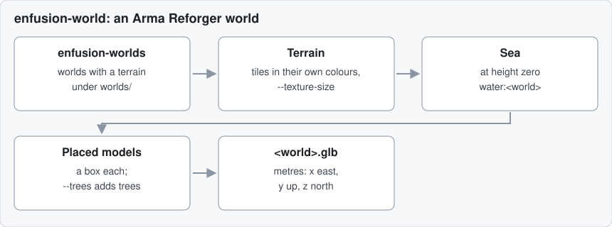

# Arma Reforger-världar: `enfusion-worlds` och `enfusion-world`

**Vad är det?** En hel Arma Reforger-värld som en 3D-fil. **Varför?** Så att värmen
från spelet har marken och byggnaderna under sig. (*Enfusion* är motorn Arma Reforger
är gjort med; en *värld* är det spelet kallar en karta.)

Exporterar en hel Enfusion-värld i det installerade Arma Reforger: terrängen i
färgerna från spelets egna supertexturrutor, havet och varje placerad modell som en
låda, i spelets egna meter.



## Steg för steg

1. **Lista världarna** som spelet har med en terräng:

   ```
   python -m heat3d_gamefiles enfusion-worlds
   python -m heat3d_gamefiles enfusion-worlds --install "D:\Games\Arma Reforger"
   ```

2. **Exportera en**, med dess mappnamn under `worlds/` som det står i listan:

   ```
   python -m heat3d_gamefiles enfusion-world <world> -o world.glb
   ```

3. **Varianter:**

   ```
   python -m heat3d_gamefiles enfusion-world <world> --trees               # vegetation också, som lådor
   python -m heat3d_gamefiles enfusion-world <world> --texture-size 0      # platt färg, liten fil
   python -m heat3d_gamefiles enfusion-world <world> --ground-spacing 4 --no-structures
   ```

4. **Öppna `world.glb`** i 3DHeat-visarens Bakgrund / nivå-panel ([läsa in en nivå](https://holdi601.github.io/3DHeat/levels.html)).

## Alternativ

| Alternativ | Standard | Betydelse |
|---|---|---|
| `<world>` | krävs | en värld så som `enfusion-worlds` skriver ut den |
| `-o`, `--out FILE` | `<world>.glb` (i `$HEAT3D_LEVELS/<game>/` när den är satt) | filen som skrivs |
| `--install FOLDER` | Steam-biblioteket som har spelet | spelets mapp |
| `--ground-spacing METRES` | 2 (terrängens egen) | terrängens vertexavstånd i filen |
| `--texture-size PIXELS` | 4096 | bildens större sida för markfärgen; 0 för platt färg |
| `--no-structures` | | lämna de placerade modellerna utanför |
| `--trees` | av | placera även träd och annan vegetation, som lådor |

## Exempel på utdata

```text
<world> -> world.glb
  ground      <n> triangles, <w> x <h> m; <n> of <n> tile-edge vertices disagree; colour <w> x <h>
  structure   <n> boxes from <n> entities
  water       <n> triangles (the sea)
  left out    <what>: <n>, ...
```

## Delarna

`ground:<world>` (terrängen), `water:<world>` (havet, på höjden noll) och
`structure:<world>` (lådorna). Koordinaterna är spelets egna: x österut, y uppåt,
z norrut, i meter, det som en inspelning i spelet rapporterar. Spelets ram är
vänsterhänt; *invert world axis* i visaren visar den utan spegling.

## Hur den läses och kontrolleras

Ingen Workbench behövs, och inget är krypterat.

| Format | Vad det är | Kontrollerat mot |
|---|---|---|
| `.pak` | en datachunk och ett katalogträd, poster lagrade eller zlib | trädet använder upp sin chunk exakt; samplade zlib-poster packas upp till exakt sin angivna storlek |
| `.edds` | en DDS-header, sedan per mipnivå `COPY`- eller `LZ4 `-chunkar | chunkade nivåer avkodas till exakt sin storlek och använder exakt sina byte |
| `.terr` / `.ttile` | en header och tiles med 16-bitars höjder | varje delad tile-kant stämmer exakt |
| supertextur | varje tiles markfärg, ungefär en meter per pixel | den stämmer med havet i höjderna; ingen vändning eller transponering passar lika bra |
| `.ent` | namn, resurs-GUID:er, sedan entiteter som typade värden | en världsfil parsas till sin sista byte |
| `resourceDatabase.rdb` | GUID till sökväg | nästan varje GUID en värld använder pekar på en fil som finns |

Objekt som markerats som stående på en absolut höjd ligger inom centimeter från den
avkodade terrängen (med rutnätet transponerat skulle de ligga meter fel). Inte ritat:
modellernas egna trianglar, träd som standard (`--trees` lägger till dem som lådor),
underentiteter, sjöar och floder, texturer med pre-DX10-headers.

**Begrepp:** spelets licens tillåter icke-kommersiell användning och förbjuder
omvänd konstruktion av spelfilerna. Att läsa din egen installation är ditt eget
beslut under den licensen; resultatet är för din egen användning och ska inte delas.
