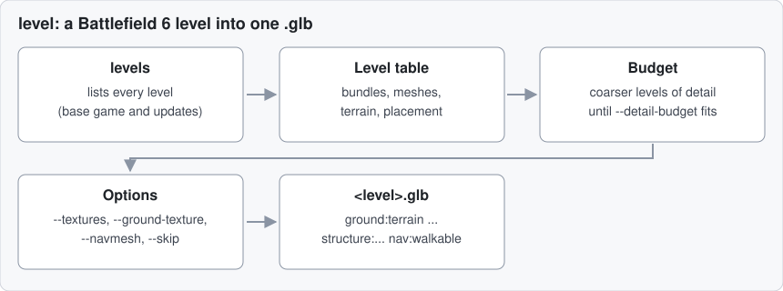

# Battlefield 6-nivåer: `levels` och `level`

**Vad är det?** En hel Battlefield 6-nivå som en 3D-fil. **Varför?** Så att värmen
från dina matcher har marken och byggnaderna under sig. (*Frostbite* är motorn
Battlefield är gjort med; ett *höjdfält* är marken lagrad som ett rutnät av höjder.)

Exporterar en hel Frostbite-nivå i det installerade spelet: terrängens höjdfält,
varje mesh som dess statiska modellgrupper placerar, objekten som placeras ett i
taget, terrängkulissen runt kartan och, på begäran, ytornas färgkartor, terrängens
dekaler inbakade i marken och soldaternas gångbara ytor.



## Steg för steg

1. **Lista nivåerna** som spelet levereras med:

   ```
   python -m heat3d_gamefiles levels
   python -m heat3d_gamefiles levels --install "D:\Games\<spelmapp>"
   ```

   Varje rad är en nivåtabell (`levels/<level>/<level>.toc`) med sin storlek och
   varifrån den kommer: `Data` för grundspelet, `Update/<pack>` för en uppdatering.

2. **Exportera en**, med dess namn, en unik del av det, eller dess `.toc`-sökväg. Börja
   utan textur för att se formen och storleken:

   ```
   python -m heat3d_gamefiles level <level> -o level.glb
   ```

3. **Lägg till färg** när den ser rätt ut:

   ```
   python -m heat3d_gamefiles level <level> -o level.glb --textures 512 --ground-texture 0.5
   ```

4. **Lägg till de gångbara ytorna**, eller gör filen mindre:

   ```
   python -m heat3d_gamefiles level <level> --textures 512 --ground-texture 0.5 --navmesh
   python -m heat3d_gamefiles level <level> --textures 256 --detail-budget 3000000 --ground-spacing 8
   ```

5. **Öppna `level.glb`** i 3DHeat-visarens Bakgrund / nivå-panel ([läsa in en nivå](https://holdi601.github.io/3DHeat/levels.html)).

## Alternativ

| Alternativ | Standard | Betydelse |
|---|---|---|
| `<level>` | krävs | ett namn så som `levels` skriver ut det, en unik del av ett, eller en nivås `.toc` |
| `-o`, `--out FILE` | `<level>.glb` (i `$HEAT3D_LEVELS/<game>/` när den är satt) | filen som skrivs |
| `--install FOLDER` | hittas i Steam-biblioteken | spelets mapp |
| `--textures [PIXELS]` | av; 512 utan storlek | varje ytas färgkarta, högst PIXELS på en sida |
| `--ground-texture [METRES]` | av; 0,5 utan storlek | bakar vägar, plattor och markeringar in i markens färg, METRES per pixel |
| `--navmesh` | av | lägger till soldatens navigeringsmesh som `nav:walkable` |
| `--ground-spacing METRES` | 4 | höjdfältets finaste avstånd; 0 lämnar det utanför |
| `--detail-budget N` | grövsta kopiorna plus en fjärdedel, minst 1 500 000 | ett tak för trianglar (terrängen grövs aldrig ned) |
| `--skip TEXT` | | lämna modellgrupper utanför vars partitionsnamn innehåller TEXT; kan upprepas |
| `--by-mesh` | av | en del per källmesh och material, för att hitta vad en del är |
| `--clamped-uvs` | av | för renderare som inte kan upprepa en textur |

Hela tabellen, med storlekarna att vänta sig (en hel nivå är hundratals MB), finns
på [Kommandon](commands.md#levels-and-level-frostbite). Hur tabellerna, paketen,
meshar och terrängen läses finns på [Frostbite](reader-frostbite.md).

## Exempel på utdata

Vad `level` skriver ut, i grova drag (raderna så som koden skriver dem; `<n>` och
namnen varierar mellan nivåer):

```text
<n> copies of <n> meshes, from <n> static model groups
      <n>  <group>
      <n>  placed one by one (object and prefab references)
<n> meshes left out: <why>
<n> triangles, budget <n>; <n> meshes drawn at a coarser level to fit
           <n>  ground:terrain
           <n>  structure:buildings, <n> textures
           ...
<n> of <n> drawn sections carry their colour map; the rest are flat colours
Ground: <what the ground is>.
Navigation mesh: <tiles read>.
-> level.glb (<n> MB)
```

## Delarna

`ground:terrain` (höjdfältet), `ground:terrain backdrop` och
`ground:terrain blend`, `structure:<kind>` per slag av mesh (per färgkarta med
`--textures`, med ` (destructible)` för det som kan förstöras i en match), och
`nav:walkable` med `--navmesh`. Se [Filformat](output-format.md).

Filen innehåller spelets innehåll: den är till för datorn den gjordes på, inte för
att skickas runt ([Regler och licenser](rules-and-licences.md)).
