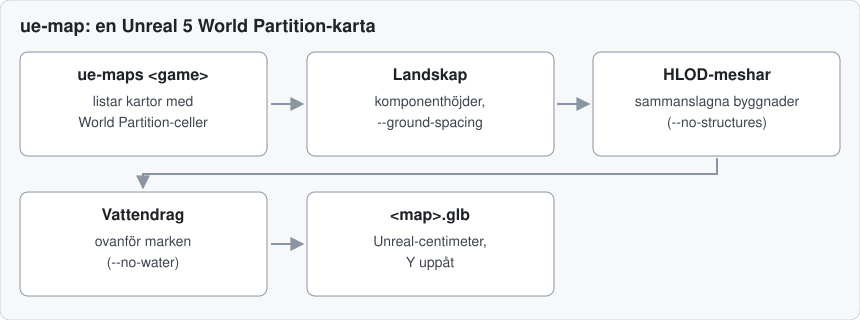

# Unreal 5 World Partition-kartor: `ue-maps` och `ue-map` {#unreal-5-world-partition-maps-ue-maps-and-ue-map}

**Vad är det?** En hel karta från ett Unreal 5-spel som en 3D-fil: marken, byggnaderna
och vattnet. **Varför?** Så att värmen från spelet har kartan under sig. (*World
Partition* är hur Unreal 5 delar upp en stor karta i bitar; *HLOD* är en förenklad
ersättning för en grupp byggnader, den som spelet ritar på långt håll.)

Exporterar en hel karta från ett Unreal 5-spel vars kartor är cachade som World
Partition-celler: landskapet, kartans sammanslagna HLOD-meshar (dess byggnader och
rekvisita så som spelet ritar dem på avstånd) och dess vattenkroppar. Ingen editor
och inget projekt behövs, bara det installerade spelet.



## Steg för steg {#step-by-step}

1. **Lista kartorna.** `<game>` är spelets mapp, dess `Content/Paks`, eller namnet på
   dess mapp i ett Steam-bibliotek:

   ```
   python -m heat3d_gamefiles ue-maps "<Steam-spelmappens namn>"
   python -m heat3d_gamefiles ue-maps "D:\Games\<game>"
   ```

   Varje karta med cachade World Partition-celler skrivs ut med sin paketsökväg.

2. **Exportera en** med dess namn eller en unik del av det:

   ```
   python -m heat3d_gamefiles ue-map "<game>" <map> -o map.glb
   ```

3. **Bara mark, eller grövre:**

   ```
   python -m heat3d_gamefiles ue-map "<game>" <map> --no-structures --no-water
   python -m heat3d_gamefiles ue-map "<game>" <map> --ground-spacing 4
   ```

4. **Öppna `map.glb`** i 3DHeat-visarens Bakgrund / nivå-panel
   ([läsa in en nivå](https://holdi601.github.io/3DHeat/levels.html)).

## Alternativ {#options}

| Alternativ | Standard | Betydelse |
|---|---|---|
| `<game>` | krävs | spelets mapp, dess `Content/Paks`, eller dess Steam-mappnamn |
| `<map>` | krävs | ett namn så som `ue-maps` skriver ut det, eller en unik del av ett |
| `-o`, `--out FILE` | `<map>.glb` (i `$HEAT3D_LEVELS/<game>/` när den är satt) | filen som skrivs |
| `--ground-spacing METRES` | 2 | landskapets vertexavstånd, avrundat till ett helt antal av sina egna rutor |
| `--no-structures` | | lämna HLOD-byggnaderna och rekvisitan utanför |
| `--no-water` | | lämna vattenkropparna utanför |

Innehåll som är komprimerat med Oodle behöver ett Oodle-bibliotek som redan finns på
datorn (se [Oodle](reader-oodle.md)).

## Exempel på utdata {#example-output}

```text
<map> -> map.glb
  ground      <n> triangles from <n> landscape components; <n> of <n> vertices stored twice disagree
  structure   <n> triangles in <n> HLOD meshes
  water       <n> triangles from <n> water bodies
```

Antalet oeniga punkter är en självkontroll: grannlandskapskomponenter lagrar sin
gemensamma kant två gånger, och de två måste stämma. En 3 km karta på 2 m är cirka
4,6 miljoner marktrianglar.

## Delarna {#the-parts}

`ground:<map>` (landskapet), `structure:<map>` (HLOD-meshen) och
`water:<map>` (vatten som står över marken).

**Enheter:** det här är den enda exporten **som inte är i meter**: Unreal-centimeter,
med Y och Z bytta (Y uppåt), den ram som 3DHeat Unreal Exporter skriver. Telemetri
från samma spel använder samma ram, så den ligger rätt på kartan.

## Hur den läses och kontrolleras {#how-it-is-read-and-checked}

| Del | Läses från | Kontrollerat mot |
|---|---|---|
| mark | varje landskapskomponents 16-bitars höjdkarta, placerad via sin sektionsbas på landskapets transform | varje vertex som lagras två gånger (på en söm eller en komponentkant) måste stämma; oeniga punkter räknas och skrivs ut, de jämnas inte ut |
| struktur | kartans sammanslagna HLOD-meshar, byggda av motorn i världsrymd | en mesh behålls bara om den omslutningsruta som dess komponent cachar beskriver dess egna vertexar |
| vatten | varje vattenkropps mesh, lagd på markrutnätet och behållen där den står över marken | vatten ligger några meter över marken under det, som en flod över sin bädd |

Landskapets egenskaper hittas efter form, inte efter platsnummer (platserna flyttar
sig mellan motorversioner). Strukturerna är de förenklade ersättningarna, inte de
fullt detaljerade modellerna. Växtlighet, dekaler och landskapsmaterial exporteras
inte; marken saknar textur och skuggas av visaren. Detaljer om arkiven:
[Unreal 5 IoStore](reader-unreal-iostore.md).

**Begrepp:** spelens licenser tillåter oftast personligt, icke-kommersiellt bruk och
förbjuder omvänd konstruktion "i den mån sådana handlingar inte kan förbjudas enligt
lag". Att läsa din egen installation är ditt eget beslut under dem; resultatet är för
din egen användning och ska inte delas.
