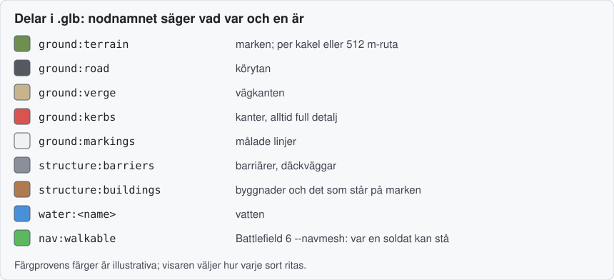

# Utdataformat {#output-format}

En `.glb` är en 3D-fil: marken, byggnaderna och vattnet i en bana eller nivå, som du öppnar i
3DHeat-visarens panel Bakgrund / nivå.

Varje export (`course`, `courses`, `terrain`, `level`, `ue-map`, `enfusion-world`) skriver en
**binär glTF 2.0**-fil (`.glb`). Den är medvetet liten och platt, och lagd ut så som 3DHeat-visaren
läser en nivå. Källa:
[`glb.py`](https://github.com/Holdi601/3DHeat-GameFiles/blob/main/heat3d_gamefiles/glb.py).

## Struktur {#structure}

```
scene 0
 ├─ node "ground:terrain x-2046 z1023"  -> mesh 0 -> 1 primitive, material 0
 ├─ node "ground:road x-2046 z1023"     -> mesh 1 -> 1 primitive, material 1
 ├─ node "ground:markings"               -> mesh 2 -> ...
 ├─ node "ground:kerbs road_gen_rum_..." -> ...
 ├─ node "structure:barriers bar_armco_bclr"
 └─ ...
```

- **En nod per del**, alla i scenens rot, **utan transformeringar**. All geometri ligger redan i
  världskoordinater.
- Varje nod har sin egen mesh med **en primitive** och sitt eget material. Noden, meshen och
  materialet bär alla delens namn.
- Varje primitive har **sina egna kompakta vertex-arrayer**, bara de hörn den delen använder. En
  delad vertex-array är giltig glTF, men en läsare som expanderar varje primitives accessorer skulle
  då hålla varje hörn en gång per del.
- `asset.generator` är `heat3d_gamefiles`.
- **Få `extras`**, och inget varv-, spel- eller banenamn:
  - en Battlefield 6-del av en sönderslagbar mesh bär `{"destructible": true}` på sin nod;
  - en Forza-bana anger vad den innehåller i `asset.extras` (formatversion, matchat rutt-id, hur många
    kopior av loppets eget lager, venues; se
    [Forza Horizon-banor](https://holdi601.github.io/3DHeat-Ext-Forza/course-forza-horizon.html#writing-the-file)), och dess påslagna delar bär sitt
    lager på noden: `{"layer": "event", "route": <id>}` för loppets eget lager, `{"layer": "layer"}` för
    ett annat påslaget lager, `{"layer": "venue"}` för ett venues mark.

  Allt annat som visaren behöver finns i nodnamnen.

## Nodnamn: klassificeringen {#node-names-the-classification}



Visaren tar en dels klass från **nodnamnet** (faller tillbaka till meshnamnet), och bara när
det matchar

```
^(ground|structure|water)\s*[:|]
```

Allt annat klassificeras av en heuristik skriven för Unreal-landskap. Så varje del exportören
skriver börjar med ett av dessa prefix, eller med `nav:` (nedan):

| Prefix | Betydelse | Delar som skrivs |
|---|---|---|
| `ground:` | körytan och marken | `ground:road`, `ground:verge`, `ground:terrain`, `ground:gravel and dirt`, `ground:kerbs`, `ground:markings`, `ground:tyre marks`, `ground:venue`, `ground:plinths` |
| `structure:` | det som står på den | `structure:barriers`, `structure:props`, `structure:signs`, `structure:buildings`, `structure:infrastructure`, `structure:bridges`, `structure:rocks`, `structure:smashables`, `structure:trees`; Forza-lager `structure:event_<category>` och `structure:layer_<category>` |
| `water:` | vatten | `water:water`; `water:<map>` (`ue-map`), `water:<world>` (`enfusion-world`) |
| `nav:` | var en soldat kan gå (Battlefield 6, bara `--navmesh`) | `nav:walkable` |

`nav:` matchar inte visarens mönster ovan, så visaren sorterar den med sin heuristik; den är en
egen del så att du kan visa eller dölja den för sig.
`ue-map` skriver `ground:<map>`, `structure:<map>` och `water:<map>`;
`enfusion-world` skriver `ground:<world>`, `structure:<world>` och `water:<world>`.

Efter slaget kommer, beroende på spelet:

| Exempel | Betydelse |
|---|---|
| `ground:road x-2046 z1023` | Forza-mark i terrängkakelt `x-2046 z1023` (rutnätsenheter, 1023 per 512 m) |
| `ground:road 3_-2` | BeamNG-mark i 512 m-kvadrat (3, -2) |
| `ground:road 3_-2 asphalt_light` | BeamNG modellerad körbana av materialet `asphalt_light` i den kvadraten |
| `ground:road 1_-4` | AC Rally-mark i 512 m-kvadrat (1, -4) i Unreal-rymden |
| `structure:barriers bar_armco_bclr` | Forza-placerade modeller som delar en textur (dess namn utan GUID) |
| `structure:barriers` | placerade modeller utan textur (Forza, AC Rally) |
| `structure:event_barriers bar_example_bclr` | Forza: det det matchade loppet levererar för sig själv, skilt från den fria världen (nodens extras `{"layer": "event", "route": <id>}`) |
| `structure:layer_props` | Forza: ett lager spelet slår på för något annat än loppet (en aktivitet, ett samlarföremål, ett runtime-lager) |
| `ground:venue`, `ground:plinths` | Forza: modeller redan i världskoordinater - ett venues egen mark (ett stadions golv), och mark en gata är dekorerad med |
| `structure:barriers armco_metal` | BeamNG-placerade modeller av ett material |
| `ground:markings`, `water:water` | platta delar, en för hela filen |
| `ground:terrain` (Battlefield 6) | höjdfältet; `ground:terrain backdrop` de avlägsna terrängmesharna, `ground:terrain blend` meshar som går över i terrängen |
| `nav:walkable` (Battlefield 6, `--navmesh`) | nivåns navigeringsmesh för en soldat: där man kan stå, platt grönt |
| `ground:terrain x-512 z-512` (Battlefield 6, `--ground-texture`) | höjdfältet under en inbakad dekalkakel, namngiven efter kakelns låga hörn i meter |
| `structure:buildings t_concreteclean_01_cs` (Battlefield 6, `--textures`) | varje yta av den typen som visar den färgkartan; utan `--textures` en del per typ, utan suffix |
| `structure:buildings t_concreteclean_01_cs (destructible)` (Battlefield 6) | samma, för meshar en match kan förstöra: de som har en förstörelsetillgång med sitt eget namn (väggar, hus, rekvisita). Noden bär också glTF-extrat `{"destructible": true}`. Deras förstörda tillstånd exporteras inte |

Visaren kan filtrera på dessa namn. Till exempel är "bara racingytan" `ground:road` tillsammans
med `ground:kerbs`, i alla tre spelen, och "världen utan loppets egna rekvisita" är allt utom
`structure:event_*`. Prefixet är också hur visaren ritar en del: mark som ytan värmen ligger på,
structure som det som står på den.

## Enheter, axlar och koordinatsystem {#units-axes-and-frame}

- **Meter, Y uppåt**, glTF:s konvention, för varje export utom `ue-map`. Inget skalas om eller
  centreras om: siffrorna är spelets egna världskoordinater, vilket är poängen med att läsa
  arkivet i stället för att rekonstruera.
- **Unreal 5-kartor (`ue-map`): centimeter**, Unreals egen enhet, med Y och Z bytta så att Y är
  uppåt - det koordinatsystem 3DHeat Unreal Exporter skriver och spelets telemetri använder. Den
  enda exporten som inte är i meter.
- **Arma Reforger (`enfusion-world`):** spelets egna meter, x österut, y uppåt, z norrut. Spelets
  koordinatsystem är vänsterhänt; visarens *invert world axis* visar det utan spegling.
- **Forza:** spelets egna världskoordinater (x, y uppåt, z), oförändrade. Samma som dess telemetri,
  så ett inspelat varv ligger på banan.
- **BeamNG.drive:** `(x, z, -y)` av BeamNG:s Z-uppåt-värld, vilket är den rotation
  telemetriinspelaren använder. En rotation, inte en spegling.
- **Battlefield 6:** spelets egna världskoordinater (x, y uppåt, z), oförändrade: nivåns
  instanstransformer tillämpade på varje mesh så som de lagrats. Speglade kopior vänds om så att
  deras normaler pekar utåt.
- **Assetto Corsa Rally:** varvets koordinatsystem. Unreal-centimeter blir meter, Unreal-Z blir y,
  och Unreal-X och Y blir x och z i den av de åtta orienteringar varvet passade (se
  [Assetto Corsa Rally](https://holdi601.github.io/3DHeat-Ext-ACRally/course-assetto-corsa-rally.html#which-stage-and-which-way-round)).
  Trianglar vänds om där avbildningen speglar.

Varje export behåller de axlar dess telemetri använder, så inspelningen och nivån delar
koordinatsystem. Om det koordinatsystemet är vänster- eller högerhänt i varje spel är
inte kontrollerat.

## Vertexdata {#vertex-data}

Standard är den **kvantiserade** formen (`quantize=True`). Den kräver tillägget
`KHR_mesh_quantization`, som står i både `extensionsUsed` och `extensionsRequired`.

| Attribut | Kvantiserad (standard) | Full precision (`quantize=False`) |
|---|---|---|
| `POSITION` | float32 VEC3, med min/max | float32 VEC3 |
| `NORMAL` | int8 VEC3 normaliserad, utfylld till 4 byte (steg 4) | float32 VEC3 |
| `TEXCOORD_0` (bara texturerade delar) | uint16 VEC2 normaliserad, begränsad till 0-1; float32 VEC2 där texturer upprepas (Battlefield 6) | float32 VEC2 |
| `COLOR_0` (otexturerade delar, när någon del har en färg) | uint8 VEC3 normaliserad, utfylld till 4 byte | float32 VEC3 |
| index | uint16 när delen har högst 65 535 hörn, annars uint32 | uint32 |

Ett hörn är 20 byte i stället för 32 (24 i stället för 44 med färg). Det tar en tredjedel av varje
fil, och det är skillnaden mellan att en stadsbana laddas i en webbläsarflik och att den inte gör
det. Kostnaden är under en halv grad normal och 1/65 535 av en UV (en femtondel av en texel vid
4 096 px). Kommandoraden skriver alltid den kvantiserade formen. `write_glb(..., quantize=False)`
i Python skriver den andra.

Normaler kommer från spelet där det lagrar dem (Forza-mark och -modeller, BeamNG-former och
-terräng). Annars räknas de ut som areaviktade släta normaler från trianglarna. AC Rally-normaler
räknas alltid ut.

## Material, färger och texturer {#materials-colours-and-textures}

- Varje material är `metallicFactor 0`, `roughnessFactor 1`.
- **Texturerad del:** `baseColorTexture` med delens bild, UV:er och ingen vertexfärg. glTF multiplicerar
  de två, så en yta skulle bli mörkare två gånger.
- **Otexturerad del:** vertexfärgen `COLOR_0` med delens platta färg, och en vit `baseColorFactor`. Om
  ingen del i filen har en färg finns ingen `COLOR_0`. Där delar delar hörn vinner senare delens färg,
  så platta delar skrivs i ordning efter växande vikt.
- **Bilder** bäddas in i den binära delen som **JPEG**, kvalitet 90, ingen kroma-subsampling, bara
  RGB (alfan släpps) - utom en Battlefield 6-utklippskarta (löv, staket), som är **PNG** med sin alfa, på
  ett material med `alphaMode` MASK, `alphaCutoff` 0.5 och `doubleSided` (se
  [Frostbite](https://holdi601.github.io/3DHeat-Ext-Battlefield/reader-frostbite.html#textures-and-materials)). 3DHeat-visaren kasserar texeler under
  gränsen. En 2048 px mark av gräs och trädkronor är brus för en förlustfri kodare: flera megabyte per
  kakel som PNG, under ett som JPEG. En bild som flera delar delar lagras en gång.
- En sampler för alla texturer: linjär förstoring, linear-mipmap-linear förminskning, **clamp to edge**
  på båda axlarna, för bansexporterna, vars texturer täcker sina ytor en gång. BeamNG ritar upprepande
  modelltexturer som platta färger (se [BeamNG.drive](https://holdi601.github.io/3DHeat-Ext-BeamNG/course-beamng.html#placed-models)).
- En Battlefield 6-export med `--textures`, vars material kakelbeläggs, skriver spelets egna
  texturkoordinater, oklämda, som float32 `TEXCOORD_0` även i den kvantiserade formen, med en sampler som
  **upprepar** på båda axlarna (`write_glb(..., repeat=True)`): en tegelvägg är ett par trianglar vars UV
  går från 0 till 40. 3DHeat-visaren lindar en sådan textur i sin atlas (se dess sida *Model levels*).
  För en renderare som inte kan upprepa en textur klipper `level --clamped-uvs`
  (`write_level(..., clamped=True)`) varje triangel längs linjerna där dess textur upprepas och flyttar
  varje bit in i 0..1: samma pixlar på samma yta, cirka en femtedel fler trianglar. Trianglar där en
  textur upprepas mer än 16 gånger behåller sina koordinater. En triangel som dess textur skulle klippa i
  fler än 4 bitar - bark som upprepas nedför varje gren på ett träd, vilket klippet gjorde av ett träds
  1 099 trianglar till 51 735 - går i en egen del, `<part> (average colour)`, i texturens medelfärg;
  `level` säger hur många.

| Textur | Storlek | Täcker |
|---|---|---|
| mark (alla spel utom Battlefield 6) | `--texture-size`: 2048, 1024 eller 512 px | en 512 m-kvadrat: 25, 50 eller 100 cm per pixel |
| Battlefield 6-höjdfält | bakgrundens färgkartas största mip i nivån, beskuren | terrängkvadraten: 32 m per pixel i den nivå som kontrollerats |
| Battlefield 6-ytor | `--textures`: högst så många px på en sida | ytans egen textur, en gång per bit (klippt där den upprepas) |
| Battlefield 6-inbakad mark | `--ground-texture`: meter per pixel, kakel på högst 4 096 px | ett kakel av dekalernas utsträckning: 2 048 m vid 0,5 m per pixel |
| Forza-placerad modell | högst 256 px | modellens egen UV-layout |
| BeamNG-placerad modell | högst 256 px | modellens egen UV-layout, bara där den inte upprepas |
| AC Rally-placerad modell | ingen | platta färger |

## Vad skrivaren vägrar {#what-the-writer-refuses}

`write_glb` kastar ett fel i stället för att skriva en fil som en visare skulle öppna men visa fel:

| Vägrat | Eftersom |
|---|---|
| positioner som inte är N x 3, eller inte ändliga | en trasig mesh |
| ett index förbi slutet av vertexlistan | renderas som brus |
| en texturerad del när filen saknar UV:er | renderas som en utsmetad pixel |
| inga trianglar alls | renderas som ingenting |
| en normal-, färg- eller UV-array med fel längd, eller som inte är ändlig | en per hörn behövs |

## Läsa den någon annanstans {#reading-it-elsewhere}

Varje glTF 2.0-visare som stöder `KHR_mesh_quantization` bör öppna dessa filer. Bara
3DHeat-visaren är kontrollerad; andra visare är inte verifierade. En läsare utan tillägget
vägrar filen, eftersom den är markerad som krävd. Filerna kan bli stora: ungefär 80 MB för en
landsvägsbana, upp till flera hundra MB för en stadsbana med den automatiska budgeten.

## I 3DHeat {#in-3dheat}

Ladda `.glb`-filen i [3DHeat](https://github.com/Holdi601/3DHeat)-visarens panel Bakgrund / nivå;
telemetrin du spelar in i samma spel ligger på den, eftersom båda behåller spelets koordinater. Visarens
egen dokumentation ([holdi601.github.io/3DHeat](https://holdi601.github.io/3DHeat/)) täcker panelen
Bakgrund / nivå och matchfilerna som de andra verktygen skriver
([One file a match: `.3dheat`](https://holdi601.github.io/3DHeat/container.html)).
En nivå lagras inte i varje `.3dheat`-fil: en match anger den i sina `references` (`kind: "level"`, namn
och sha256) och `.glb`-filen ligger kvar bredvid matcherna.
