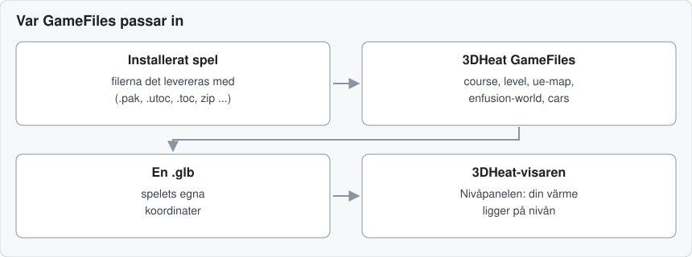

# Hela nivåer {#whole-levels}

**Med enkla ord:** för shooters och andra spel utan varv sparar verktyget hela kartan som en 3D-fil, så att visaren kan rita var spelarna gick på den.

`course` klipper ut marken runt ett varv. För spel utan varv exporterar verktyget en hel nivå, karta eller värld på en gång:

| Spel eller motor | Lista | Exportera | Sida |
|---|---|---|---|
| Battlefield 6 (Frostbite) | `levels` | `level <level>` | [Battlefield 6-nivåer](level-battlefield.md) |
| Unreal 5 World Partition-spel | `ue-maps <game>` | `ue-map <game> <map>` | [Unreal 5-kartor](level-unreal-world-partition.md) |
| Arma Reforger (Enfusion) | `enfusion-worlds` | `enfusion-world <world>` | [Arma Reforger-världar](level-arma-reforger.md) |

Varje par fungerar på samma sätt: det första verbet listar vad det installerade spelet innehåller, det andra skriver en av dem som en enda `.glb` i spelets egna världskoordinater, så att positioner som spelats in i spelet ligger rätt på den. Delarna heter `ground:`, `structure:` och `water:` precis som alla andra exporter (se [Utdataformat](output-format.md)). Läs in filen i 3DHeat-visarens nivåpanel.

