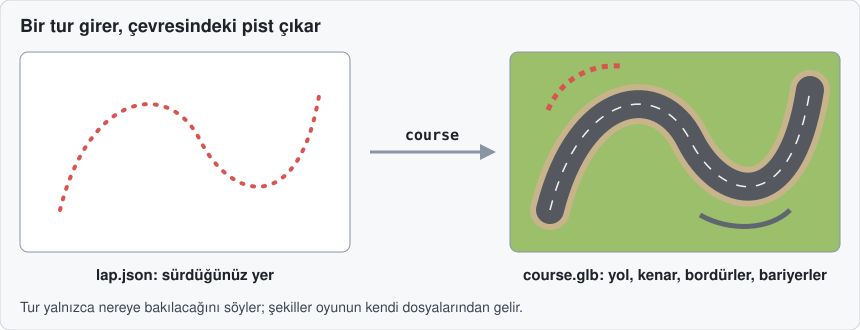
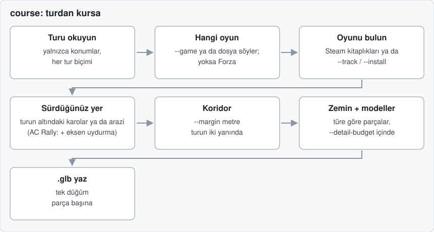

# Parkur dışa aktarma {#course-export}

**Kısaca:** bir tur attınız; bu, sürdüğünüz pistin 3D dosyasını oluşturur. Tur yalnızca bir nokta dizisidir; yol, çimen ve bordürler oyunun kendi dosyalarından gelir.

`course`, bir turu bir parkura dönüştürür: arabanın gittiği yerin iki yanındaki bir bantta zemin ve o zeminin üstünde duran şeyler, 3DHeat görüntüleyici için tek bir `.glb` olarak. Bu sayfa desteklenen üç oyunun ortak noktalarını anlatır. Altındaki sayfalar farklı olanları anlatır:

- [Forza Horizon](course-forza-horizon.md): ForzaTech `.minizip` arşivleri
- [BeamNG.drive](course-beamng.md): zip arşivleri, bir arazi yükseklik alanı, derlenmiş şekiller
- [Assetto Corsa Rally](course-assetto-corsa-rally.md): Unreal 5 IoStore, bir World Partition etabı
- [Ayrıntı düzeyleri ve bütçe](detail-budget.md): yerleştirilmiş modellerin kaç üçgen alacağı ve hangi kopyaların kalacağı

## Adımlar {#the-steps}

Aşağıda kullanılan sözcükler: bir **çerçeve**, eksenlerin hangi yöne baktığıdır; **koridor**, turun iki yanındaki zemin bandıdır; bir **karo**, bir oyun arazisinin tek bir kare parçasıdır; bir **LOD** (ayrıntı düzeyi), bir modelin daha sade kopyalarından biridir.

1. **Turu oku.** Yalnızca konumlar, [Tur girdileri](lap-inputs.md) sayfasındaki şekillerin herhangi birinden. Hız ve girdiler kullanılmaz. İkiden az örneği olan bir tur reddedilir ("holds no driving").
2. **Oyunu belirle.** Sırayla `--game`, sonra tur dosyasının kendi `game` alanı, sonra Forza ([Komutlar](commands.md#which-game) sayfasına bakın).
3. **Kurulu oyunu bul.** Üçü de Steam'in `config\libraryfolders.vdf` dosyasında listelenen her Steam kütüphanesini tarar. Forza ayrıca `C:\XboxGames` klasörüne de bakar. `--track` (Forza) ya da `--install` (BeamNG, AC Rally) aramayı atlar.
4. **Turun sürüldüğü yeri bul.** Bu, asla yalnızca bir ad eşleşmesiyle belirlenmez. Forza, arazi karoları turu kapsayan parkuru seçer. BeamNG, turun örneklerinin üzerinde durduğu seviyenin arazisini (ya da yollarını) seçer. AC Rally, her etabı sekiz eksen yönelimiyle dener ve turun en çok kısmını yola düşüren yönelimi seçer.
5. **Bir koridor kes**: sürüşün her iki yanında `--margin` metre (aşağıya bakın).
6. **Koridorun içinde zemini oluştur**; yol, kenar, çakıl ve toprak, arazi, çizgiler, lastik izleri ya da su olarak sınıflandır ve her 512 m'lik kare için bir zemin dokusu pişir.
7. **Koridorda duran modelleri yerleştir**, kategorilerine göre, mesafeye ve bir üçgen bütçesine göre seçilen bir ayrıntı düzeyinde.
8. **`.glb` dosyasını yaz**: parça başına adlandırılmış bir düğüm. Bkz. [Çıktı biçimi](output-format.md).

Bir çalıştırmanın ne yazdığı: burada, testlerin kurduğu sentetik bir BeamNG.drive kurulumunda, yalnızca bir yol şeridinden aşağı inen 50 m'lik bir tur:

## Koridor {#the-corridor}

Kesim, turun sınır kutusu değil, sürülen çizginin etrafındaki bir banttır. Dairesel bir parkurda ikisi neredeyse aynıdır. Noktadan noktaya bir sprintte ise kutu çoğunlukla kimsenin geçmediği bir yamaçtır ve bant alanının onda biri kadar olabilir. Kaynak: [`corridor.py`](https://github.com/Holdi601/3DHeat-GameFiles/blob/main/heat3d_gamefiles/corridor.py).

Nasıl kurulur:

- Sürüş zemin düzlemine yansıtılır: turun x ve z'si (BeamNG: oyunun kendi çerçevesinin x ve y'si).
- Bir **4 m**'lik hücre ızgarasında (`CELL`) raster'lanır. Sürüşün dokunduğu her hücre, her yönde `margin + 4 m` yarıçaplı bir diskle genişletilir.
- Birbirini izleyen, **50 m**'den (`JOIN`) yakın örnekler, her 4 m'de bir noktayla birleştirilir; böylece bandın boşluğu olmaz. Daha uzak örnekler ayrı sürüş parçaları sayılır ve birleştirilmez. Bir kütüphane parkuru, uçtan uca eklenmiş birçok tur dosyasıdır; bir sprintin bitişi ile sonrakinin başlangıcı haritada bir bant çizmemelidir.
- Bir üçgen, köşelerinden, kenarlarının orta noktalarından ya da ağırlık merkezinden herhangi biri bantın içindeyse tutulur. Orta noktalar, köşeleri bant dışında kalan ama bandı kesen büyük üçgenleri yakalar.
- Yükseklik kesime asla dahil edilmez. Yüksekliği sınırlayan bir kutu, yolun tırmandığı tepenin altındaki zemini keserdi.

Konsol bandın alanını bildirir, örneğin: `cutting 80 m either side of the driving: 1.53 km2 of a 6,000 by 3,600 m box`.

BeamNG ve AC Rally ayrıca daha geniş bir **ulaşım** koridoru (`margin + 60 m`) kurar. Yerleştirilmiş bir modelin orijini ulaşım koridorundaysa ele alınır, ve ayak izi gerçek koridora değiyorsa çizilir. Böylece bandın hemen dışında orijini olan uzun bir nesne kaybolmaz. BeamNG ayrıca yol çıkartmalarından hangilerinin boyanacağını seçmek için ulaşım koridorunu kullanır.

## Zemin neyden oluşur {#what-the-ground-is-made-of}

Her dışa aktarım zemin üçgenlerini aynı türlere ayırır ve her tür kendi parçası olarak yazılır; böylece görüntüleyici onu gösterebilir ya da gizleyebilir:

| Tür | Parça adı | Düz renk (doğrusal RGB) | Forza | BeamNG | AC Rally |
|---|---|---|---|---|---|
| yol | `ground:road` | 0.22, 0.22, 0.23 | yol şeritleri: asfalt parçası | `ASPHALT` türü katmanlar, yol çıkartmaları, modellenmiş yol | parkur karoları (`/MeshesTrack/`) |
| kenar | `ground:verge` | 0.52, 0.47, 0.30 | yol şeritleri: omuz | kaldırımlar ve kenar modelleri | - |
| çakıl ve toprak | `ground:gravel and dirt` | 0.50, 0.42, 0.30 | - | toprak, çakıl, kum, çamur katmanları ve çıkartmaları | - |
| arazi | `ground:terrain` | 0.30, 0.44, 0.18 | geri kalan her şey | geri kalan her şey | `_Terrain` karoları ve uzak arazi |
| bordürler | `ground:kerbs` | 0.60, 0.12, 0.10 (Forza) | `road_gen_rum*` nesneleri | bordür, kaldırım ve titreşim modelleri | bordür modelleri |
| çizgiler | `ground:markings` | 0.90, 0.90, 0.88 | decal alt ağları, 5 cm kaldırılmış | dokuya boyanmış | - |
| lastik izleri | `ground:tyre marks` | 0.20, 0.17, 0.16 | decal alt ağları, 5 cm kaldırılmış | dokuya boyanmış | - |
| su | `water:water` | 0.16, 0.34, 0.48 | su malzemeleri | deniz düzlemi, su blokları, nehirler | - |

Düz renkler bir bakışta okunsun diye seçilmiştir, oyuna uymak için değil. Dokusuz parçalarda ve dokuları yok sayan görüntüleyicilerde kullanılırlar. Kaynak: [`surfaces.py`](https://github.com/Holdi601/3DHeat-GameFiles/blob/main/heat3d_gamefiles/surfaces.py).

Zemin parçaları 512 m'lik kareye göre bölünür ve her kare kendi pişirilmiş görüntüsünü taşır; bu yüzden parça adları kareyi de içerir:

| Oyun | Zemin parça adı | Kare anahtarı |
|---|---|---|
| Forza | `ground:road x-2046 z1023` | arazi karosunun ızgara adı (1023 adımlarla, bkz. [Forza Horizon](course-forza-horizon.md)) |
| BeamNG | `ground:road 3_-2` | BeamNG metrelerinde `floor(x / 512)`, `floor(y / 512)` |
| AC Rally | `ground:road 1_-4` | Unreal santimetrelerinde `floor(x / 51200)`, `floor(y / 51200)` |

## Üzerinde duran şeyler {#what-stands-on-it}

Yerleştirilmiş modeller `structure:<category>` adlı parçalara yazılır; bordürler için (üç oyunda da) `ground:kerbs`. Bir parçanın kendi dokusu varsa, doku ya da malzeme adı kategoriyi izler, örneğin `structure:barriers bar_armco_bclr`.

| Kategori | Forza | BeamNG | AC Rally |
|---|---|---|---|
| bariyerler | evet | evet | evet |
| donatılar | evet | evet | evet |
| tabelalar | evet | evet | evet |
| binalar | evet (oyunda bütün-bina yer tutucuları varsa onlar) | evet | evet |
| altyapı | evet | evet | evet |
| köprüler | evet | evet | (altyapı olarak sınıflandırılır) |
| kayalar | evet | evet | evet |
| bordürler | evet, zemin olarak | evet, zemin olarak | evet, zemin olarak |
| ağaçlar | `--trees` ile | `--trees` ile | `--trees` ile |
| kırılabilir nesneler | `--trees` ile | - | - |

Ayrıntının dağılımı üç oyunda da aynıdır. Sürüşün 25 m içindeki kopyalar tam ayrıntıyla başlar, 25-60 m uzaktakiler bir düzey daha kaba, daha uzaktakiler en kaba düzeyde. Sonra en pahalı modeller bir üçgen bütçesi sığana kadar bir kademe düşer; verdiğiniz bütçe için en kaba düzeyler bile sığmazsa kopyalar bırakılır. Bordürler asla sadeleştirilmez ya da bırakılmaz. Bkz. [Ayrıntı düzeyleri ve bütçe](detail-budget.md).

## Sonucu şekillendiren seçenekler {#options-that-shape-the-result}

| İstediğiniz | Kullanın |
|---|---|
| daha küçük bir dosya | `--no-textures` (düz renkler), `--texture-size 1024` ya da `512`, `--detail-budget N`, `--margin 40` |
| yalnızca zemin | `--no-placed` |
| manzara da | `--trees` |
| farklı bir mevsim (Forza) | `--season winter` |
| Steam dışında bir oyun | `--track` (Forza) ya da `--install` (BeamNG, AC Rally) |
| aramanın yerleştirmediği bir tur | `--level` (BeamNG, AC Rally), `--track` (Forza) |

## Koordinatlar {#coordinates}

Her dışa aktarım, metre cinsinden ve Y yukarı olarak, aynı oyunun kaydedilmiş bir turunun hizalandığı çerçevede yazılır:

| Oyun | Yazılan çerçeve |
|---|---|
| Forza | oyunun kendi dünya koordinatları, değiştirilmeden |
| BeamNG | BeamNG'nin Z-yukarı dünyasının `(x, z, -y)` hali; telemetri kaydedicisinin uyguladığı dönüş budur |
| AC Rally | turun çerçevesi, uydurma yoluyla bulunur: Unreal santimetreleri metreye çevrilir ve Unreal X ile Y, sekiz yönelimden uyan birinde turun x ve z'si olur |

Bkz. [Çıktı biçimi](output-format.md).
