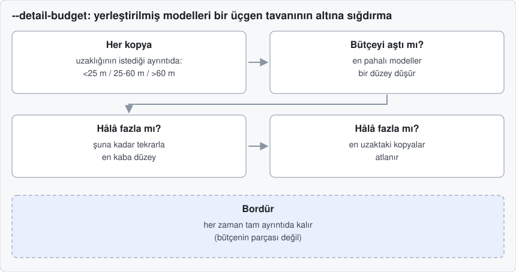

# Ayrıntı düzeyleri ve bütçe {#levels-of-detail-and-the-budget}

Bir **üçgen**, bir 3D modelin küçük, düz bir parçasıdır. Daha çok üçgen, daha büyük ve daha yavaş bir dosya demektir. **Bütçe**, bunların sayısına konan bir sınırdır. Bir **ayrıntı düzeyi (LOD)**, uzakta kullanılan bir modelin daha sade bir kopyasıdır.

Bir parkurun çevresine yerleştirilen her şeyin en ince düzeyi birkaç milyon üçgendir. Örneğin yüzlerce bariyer parçası ve lastik yığını, her biri yaklaşık bin üçgen. Bir şehir koridoru yüz binin üzerinde kopya barındırır. Bu yüzden her parkur dışa aktarımı yerleştirilmiş modellere bir **üçgen bütçesi** verir ve her model için hangi ayrıntı düzeyinde çizileceğine, gerekirse hangi kopyaların bırakılacağına karar verir.

Bu şema Forza için yazılmıştır ([`forzaplacement.py`](https://github.com/Holdi601/3DHeat-GameFiles/blob/main/heat3d_gamefiles/forzaplacement.py): `choose_levels`, `auto_budget`, `_fit`); BeamNG ve AC Rally de onun parçalarını yeniden kullanır. Arazi bütçeye dahil değildir.

## Mesafe bantları {#distance-bands}

Her kopyanın sürüşe olan mesafesi, yer düzleminde, en yakın tur örneğine göre ölçülür. Tur önce en çok 1.000 noktaya indirilir; bu birkaç metrelik bir hassasiyet kaybettirir, ama burada bir önemi yoktur. Kopyalar sonra üç banda ayrılır ve her (model, bant) çifti ayrı bütçelenir:

| Bant | Mesafe | Başlangıç |
|---|---|---|
| yakın | 25 m'nin altında (`NEAR`) | en ince düzey |
| orta | 25-60 m (`FAR`) | bir düzey daha kaba |
| uzak | 60 m ve üzeri | en kaba düzey |

Bir rota olmadan (Forza `terrain --box`), mesafe kutunun ortasına göre ölçülür.

## Bütçeye sığmak için düşürme {#stepping-down-to-fit}



Bir (model, bant) girdisinin maliyeti, kopya sayısı çarpı o anki düzeydeki üçgen sayısıdır. Toplam bütçenin üstündeyken, en çok maliyeti olan girdi bir düzey düşer; bu, toplam sığana ya da daha fazla düşemeyene kadar tekrarlanır. Sabitlenmiş girdiler hiç düşmez:

| Oyun | Tam ayrıntıda sabitlenmiş |
|---|---|
| Forza | bordürler (`road_gen_rum*`) |
| BeamNG | bordürler ve sürüş yüzeyini taşıyan her şekil |
| AC Rally | bordürler |

Forza özeti bunu şöyle bildirir:

```
N of M models drawn at a coarser level to fit the budget
```

## Otomatik bütçe {#the-automatic-budget}

`--detail-budget` verilmezse bütçe kendini, **hiçbir kopyanın bırakılmayacağı** şekilde boyutlandırır:

```
budget = max(1,500,000, 1.25 x sum(copies x coarsest level))
```

Sabitlenmiş girdiler en ince düzeylerinde sayılır. %25 (`HEADROOM`), yolun yanındaki şeylerin biraz ayrıntı tutmasına izin verir. Kırsal bir parkurda bu, 1,5 milyonluk taban (`DEFAULT_BUDGET`) olur. Yüz binden fazla kopyası olan bir şehir parkurunda ise on milyonun üstüne çıkar ve dosya birkaç yüz MB olur. Görüntüleyici bunu yükler.

## Verdiğiniz bir bütçe {#a-budget-you-give}

`--detail-budget N` bir **tavandır**. Düzeyler yukarıdaki gibi düşer. En kaba düzeyler bile sığmazsa kopyalar bırakılır:

| Oyun | Kopyaların bırakılma sırası |
|---|---|
| Forza | önce sürüşten 25 m veya daha uzakta olan her şey, sonra yolun yanındaki şeyler; her grupta önce yoldan en küçük görünen, yani en büyük mesafe / boyut (boyut = modelin sınır kutusu köşegeni çarpı en büyük ölçeği, en az 0,25 m) |
| BeamNG | önce sürüşten en uzak olan |
| AC Rally | önce sürüşten en uzak olan, BeamNG gibi |
| Battlefield 6 | önce en küçük olan: sınır kutusu köşegeni çarpı ölçek |

Bordürler (ve BeamNG için sürüş yüzeyi modelleri) asla bırakılmaz; bu yüzden onların kendi başlarına maliyetinden küçük bir bütçe, yalnızca onlar tarafından aşılır.

Forza'da mesafe tek başına değil de mesafe / boyut kullanılır, çünkü yalnızca mesafeye göre sıralansaydı, dokuz metre uzaktaki bir duvardaki klima ünitesi, on iki metre uzakta asılı olduğu yirmi metrelik cepheden daha uzun yaşardı. Boyutu ne olursa olsun yolun yanındaki şeyler en sona kalır; çünkü yoldan beş metre uzaktaki üç metrelik bir bariyer parkurun kenarıdır, geride altmış metrede duran elli metrelik bir bina ise manzaradır.

Özet şunu bildirir: `N of M copies left out to fit the budget, the smallest and furthest from the driving first (--detail-budget raises it)` (Forza), ya da `N copies left out to fit the budget, the furthest from the driving first (--detail-budget raises it)` (BeamNG, AC Rally).

## Bütün binalar (Forza) {#whole-buildings-forza}

Bütün bina yer tutucusu tek bir kopya sayılır; mesafesi binanın en yakın kenarına göre ölçülür. Bir birim olarak tutulur ya da bırakılır. Onun yerini tutan modüler parçalar hiç bütçelenmez. Bkz. [Forza Horizon](course-forza-horizon.md#buildings-drawn-whole).

## Oyun başına bir ayrıntı düzeyi nedir {#what-a-level-of-detail-is-per-game}

| Oyun | Düzeyler nereden gelir |
|---|---|
| Forza | modelin `Mesh` alt ağlarının üçgen başına düzey maskesi (bit `level + 1`); düzey işaretlenmemiş bir model için yalnızca `0xFFFF` kırılabilir parçalar |
| BeamNG | `.cdae` şeklinin, negatif olmayan boyutlu `details` değerleri, en büyükten başlayarak; `.dae` için mesh düğüm adlarının sondaki sayısı (`barrier75`, `barrier40`) |
| AC Rally | statik mesh'in saklanan ayrıntı düzeyleri, en inceden başlayarak |
| Battlefield 6 | MeshSet'in ayrıntı düzeyleri, en inceden başlayarak; yalnızca çizilen bölümler sayılır (gölge ve yalnızca derinlik kopyaları sayılmaz) ve uzak görünüm yer tutucusu olan son düzey sayılmaz (`M_LastLod`, `M_Billboard`, `M_Vista` malzemeleri: bir direğin kafes yapısı katı bir dikene dönüşür) |

Battlefield 6'nın `level` komutunun bir turu yoktur, bu yüzden mesafe bantları da yoktur: her mesh tek bir girdidir ve her kopya aynı düzeydedir. Otomatik bütçe, arka plan arazisi sabitlenmiş halde yukarıdaki formüldür; yükseklik alanı bütçenin dışındadır ve `--ground-spacing` ile boyutlandırılır. Verdiğiniz bir bütçe altında, her mesh en kaba düzeyine geldikten sonra, kopyalar önce en küçükten bırakılır. Boyut, mesh'in sınır kutusu köşegeni çarpı kopyanın ölçeğidir, çünkü mesafeyi ölçecek bir sürüş yoktur. Arka plan arazisi asla bırakılmaz. Bir seviye otomatik olarak yaklaşık on milyon üçgene ulaşır.

## Bir sayı seçmek {#choosing-a-number}

| İstediğiniz | Deneyin |
|---|---|
| her şey, yolun yakınında tam ayrıntı | otomatik bırakın |
| dosyanın birkaç kat daha küçük olması | `--detail-budget 500000` ile `--texture-size 1024` |
| yalnızca zemin | `--no-placed` (bütçe söz konusu değil) |
