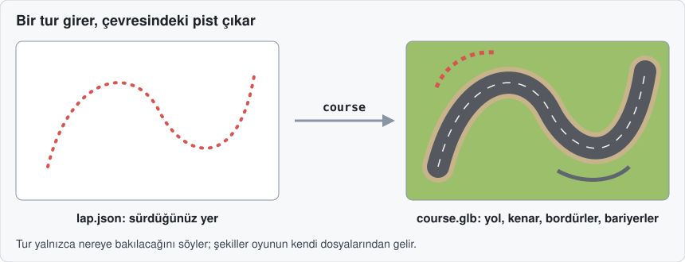
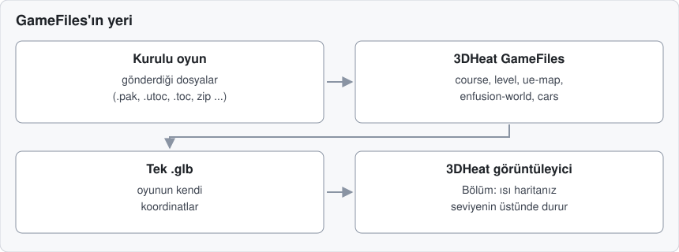

# 3DHeat GameFiles {#dheat-gamefiles}

**Nedir?** Zaten kurulu olan bir oyunun dosyalarından bir yarış pistinin ya da bir oyun seviyesinin 3B modelini oluşturan bir araç.

**Neden kullanmalıyım?** 3DHeat görüntüleyicisi, sürdüğünüz ya da oynadığınız yerleri ısı olarak boyar. Bu araçla bunu boş bir alan yerine gerçek pistin ya da seviyenin üstüne boyar.

**Örnek:** sürdüğünüz bir turu alın. Araç, çevresindeki yolu ve araziyi tek bir 3B dosya olarak oluşturur; böylece görüntüleyici hızınızı ya da kazalarınızı gerçek pistin üstünde boyayabilir:



Komut satırında yeni misiniz? [Başlamadan önce](before-you-start.md) sayfasıyla başlayın.

Ayrıntılı olarak: bir oyunun gönderdiği arşivlerdeki seviye verilerini okur ve bunu bir ikili glTF (`.glb`) dosyası olarak yazar. Başlıca işi **kurs dışa aktarımı**dır: ona bir tur verirsiniz; etrafındaki zemini, yolu (kenarından ve çimenden ayrılmış olarak), bordürleri, bariyerleri, lastik duvarları, tabelaları ve binaları yazar.

Bu araç, gerçek zamanlı 3B telemetri ısı haritaları, yarış analizi ve maç incelemesi için bir görüntüleyici olan [3DHeat](https://github.com/Holdi601/3DHeat) parçasıdır ([belgeler](https://holdi601.github.io/3DHeat/)). Bu aracın yazdığı `.glb` dosyaları, görüntüleyicinin ısıyı çizdiği seviyelerdir.



Bir seviyenin geometrisini 3DHeat'e koymanın üç yolundan biridir:

| Yol | Gerekenler | Verdiği |
|---|---|---|
| 3DHeat Unreal Exporter | editörde açık Unreal projesi | tam geometri |
| 3DHeat GameCapture | bir ekran ve bir kayıt | bir tahmin |
| **3DHeat GameFiles** | **kurulu, dağıtılmış oyun** | **tam geometri, proje gerekmez** |

Python paketi: `heat3d_gamefiles`. Depo: [Holdi601/3DHeat-GameFiles](https://github.com/Holdi601/3DHeat-GameFiles). Lisans: MIT.

## Neler yapabilir {#what-it-can-do}

| Oyun ya da motor | Kurs dışa aktarımı (`course`) | Arşiv okuma |
|---|---|---|
| Forza Horizon (ForzaTech) | evet: arazi, yol ve yol kenarı, zemin dokusu, kendi dokularında yerleştirilmiş modeller | `.minizip` üzerinde `identify`, `list`, `extract`; `.modelbin` üzerinde `identify`; modeller, arazi ve dokular `course` ve `terrain` ile |
| BeamNG.drive | evet: arazi, yol çıkartmaları, modellenmiş pistler, yerleştirilmiş modeller, su | seviye zip'lerinde `identify`, `list`, `extract`; `.ter`, `.cdae` üzerinde `identify`; `.dae` `course` ile |
| Assetto Corsa Rally (Unreal 5.6) | evet: etap arazi karoları, pişmiş zemin rengi, düz renklerle yerleştirilmiş modeller | IoStore `.utoc`/`.ucas` üzerinde `identify`, `list`, `extract`; zen paketleri, statik ağlar, dokular `course` ile |
| Unreal `.pak` (8-12 sürümleri) | hayır | `identify`, `list`, `extract` |
| Unity (22. sürüm ve sonrası) | hayır | `identify`, `meshes` |
| Battlefield 6 (Frostbite `.toc`/`.cas`) | pist yok; `level` ile bütün bir seviye: arazi, yerleştirilmiş ağlar, `--textures` ile renk haritaları | `identify`, `levels`; paketler, ağlar, arazi, dokular ve yerleşim `level` ile |
| Source 2 `.vpk` | hayır | `identify`, `list`, `extract` |
| Unreal 5 World Partition oyunları | pist yok; `ue-map` ile bütün bir harita (`ue-maps` ile listelenir): arazi, HLOD binaları ve süsler, su | - |
| Arma Reforger (Enfusion) | pist yok; `enfusion-world` ile bütün bir dünya (`enfusion-worlds` ile listelenir): kendi renkleriyle arazi, deniz, kutu olarak binalar | - |
| Forza (arabalar) | `cars`: her araba düşük ayrıntıda, görüntüleyicinin Yarış analizi sekmesi için | - |

Assetto Corsa EVO ve iRacing'den gelen turlar nedeniyle reddedilir. Bkz. [Sınırlar ve bilinen eksikler](limits-and-known-gaps.md).

## Kurulum {#install}

Komut satırında yeni misiniz? Önce [Başlamadan önce](before-you-start.md) sayfasını okuyun.

Gerekenler: **Python 3.10 veya daha yeni** (3.13 üzerinde geliştirildi) ve [`requirements.txt`](https://github.com/Holdi601/3DHeat-GameFiles/blob/main/requirements.txt) içindeki paketler.

```
git clone https://github.com/Holdi601/3DHeat-GameFiles.git
cd 3DHeat-GameFiles
pip install -r requirements.txt
```

Sonra denetleyin: `python -m heat3d_gamefiles --help`. `usage: heat3d_gamefiles [-h]` ve fiillerin listesini görmelisiniz. Her komutu aracın klasöründen, `python -m heat3d_gamefiles <fiil>` biçiminde çalıştırın.

| Paket | Ne için |
|---|---|
| numpy | geometri çözen her şey |
| lz4 | Forza arşivleri (çoğunlukla LZ4 blokları), bazı Unity paketleri, IoStore LZ4 blokları |
| Pillow | BC1-BC7 dokularını çözmek, `.glb` içine JPEG dokular yazmak |
| msgpack, zstandard | BeamNG'nin derlenmiş şekilleri (`.cdae`) |
| cryptography | yalnızca zaten elinizde olan bir anahtarla şifreli bir `.pak` açmak için |
| pytest | testler |

**Oodle** ile sıkıştırılmış Unreal içeriği, makinenizde zaten bulunan bir Oodle kitaplığı gerektirir. Bu araçla hiçbir zaman bir tane dağıtılmaz. Bkz. [Oodle](reader-oodle.md).

Araç Windows için yazıldı. Oyunları Steam'in kitaplık listesi ve `%LOCALAPPDATA%` üzerinden bulur; Oodle'ı bir Windows DLL'i olarak yükler. Diğer platformlar test edilmedi.

## Hızlı başlangıç {#quick-start}

Bir **tur dosyası**, arabanızın nereye gittiğinin kaydıdır: x, y, z noktalarının bir listesi. [3DHeat GameCapture](https://github.com/Holdi601/3DHeat-GameCapture) ya da FH Companion uygulamasının tur kitaplığından gelir; elle yazılmış bir CSV de olur ([Tur girdileri](lap-inputs.md)).

```
# Forza: a lap file, a lap folder, or a course name from the FH Companion library
python -m heat3d_gamefiles course "Example Circuit"
python -m heat3d_gamefiles course path\to\lap.json -o course.glb

# BeamNG.drive or Assetto Corsa Rally: a heat3d-lap file says which game it is from
python -m heat3d_gamefiles course my_lap.json

# Every course in the FH Companion library, one .glb each
python -m heat3d_gamefiles courses -o courses

# Battlefield 6: list the levels, then export one (a large file; see Commands)
python -m heat3d_gamefiles levels
python -m heat3d_gamefiles level <level> -o level.glb --textures

# Unreal 5 World Partition and Arma Reforger: list, then export
python -m heat3d_gamefiles ue-maps "<game>"
python -m heat3d_gamefiles ue-map "<game>" <map> -o map.glb
python -m heat3d_gamefiles enfusion-worlds
python -m heat3d_gamefiles enfusion-world <world> -o world.glb

# Every Forza car, for the viewer's race tab
python -m heat3d_gamefiles cars -o forza.h3dcars

# What is this file?
python -m heat3d_gamefiles identify some_archive.pak
```

`.glb` dosyasını 3DHeat görüntüleyicisinde açın. Oyunun kendi dünya koordinatları korunur (bkz. [Çıktı biçimi](output-format.md)), bu yüzden kaydedilen bir tur pistle hizalanır.

## Bu belgelerin haritası {#map-of-this-documentation}

- [Başlamadan önce](before-you-start.md): Python, bir terminal, ilk komut.
- [Komutlar](commands.md): her fiil ve seçenek, örneklerle.
- [Komut başvurusu](../cli-reference.md): her fiilin `--help` çıktısı, koddan üretilmiş.
- [Arşivleri inceleme](inspecting-archives.md): `identify`, `list`, `extract`, `meshes`, adım adım.
- [Kurs dışa aktarımı](course-export.md): bir turun her oyun için nasıl bir kursa dönüştüğü.
  - [Forza Horizon](course-forza-horizon.md)
  - [BeamNG.drive](course-beamng.md)
  - [Assetto Corsa Rally](course-assetto-corsa-rally.md)
  - [Ayrıntı düzeyleri ve bütçe](detail-budget.md)
- [Bütün seviyeler](whole-levels.md): tur olmadan bir seviye, harita ya da dünya.
  - [Battlefield 6 seviyeleri](level-battlefield.md): `levels`, `level`
  - [Unreal 5 haritaları](level-unreal-world-partition.md): `ue-maps`, `ue-map`
  - [Arma Reforger dünyaları](level-arma-reforger.md): `enfusion-worlds`, `enfusion-world`
- [Forza arabaları](forza-cars.md): `cars`, görüntüleyicinin yarış analizi sekmesi için araba dosyası.
- [Tur girdileri](lap-inputs.md): araç tarafından kabul edilen her tur dosyası biçimi.
- [Çıktı biçimi](output-format.md): `.glb` içinde ne var.
- [Arşiv okuyucuları](archive-readers.md): her kapsayıcı biçimi için bir sayfa; neyi okuduğu, neyi okumadığı ve nedeni.
- [Sınırlar ve bilinen eksikler](limits-and-known-gaps.md)
- [Sorun giderme](troubleshooting.md): hata iletileri ve ne yapılacağı.
- [Kurallar ve lisanslar](rules-and-licences.md): anahtar yok, kendi dosyalarınız, yeniden dağıtım yok.
- [Güncellemeler](updates.md): güncelleme denetimi ve `heat3d_update`.
- [Geliştirme](development.md): modül haritası ve testler; kurulu oyunlara karşı çalışan testler dahil.
- [Bakım](maintaining.md): bu sayfalar için sürüm kontrol listesi.

## 3DHeat'in parçası {#part-of-3dheat}

3DHeat GameFiles, 3DHeat görüntüleyicisinin etrafındaki ücretsiz araçlardan biridir:

| Araç | Ne yapar | Belgeler |
|---|---|---|
| [3DHeat](https://github.com/Holdi601/3DHeat) | görüntüleyici: tarayıcıda 3B ısı haritaları, yarış analizi ve maç incelemesi | [site](https://holdi601.github.io/3DHeat/) |
| [GameFiles](https://github.com/Holdi601/3DHeat-GameFiles) | bir oyunun gönderdiği dosyalardan kurslar ve seviyeler, `.glb` olarak | [site](https://holdi601.github.io/3DHeat-GameFiles/) |
| [GameCapture](https://github.com/Holdi601/3DHeat-GameCapture) | yarış oyunlarından tur telemetrisi; oynanış videosundan yeniden kurulan seviyeler | [site](https://holdi601.github.io/3DHeat-GameCapture/) |
| [Unreal Exporter](https://github.com/Holdi601/3DHeat-UnrealExporter) | bir seviyeyi `.glb` olarak kaydeden bir Unreal Editor eklentisi | [site](https://holdi601.github.io/3DHeat-UnrealExporter/) |
| [CS2](https://github.com/Holdi601/3DHeat-CS2) | Counter-Strike 2 demolarını maç dosyalarına; haritaları `.glb`'ye | [site](https://holdi601.github.io/3DHeat-CS2/) |
| [Watcher](https://github.com/Holdi601/3DHeat-Watcher) | oyunların yayımladığı şeylerden oynamanızı arka planda kaydeder | [site](https://holdi601.github.io/3DHeat-Watcher/) |
| [Ext-WarThunder](https://github.com/Holdi601/3DHeat-Ext-WarThunder) | War Thunder tekrarlarını maç dosyalarına | [site](https://holdi601.github.io/3DHeat-Ext-WarThunder/) |
| [Ext-WoT](https://github.com/Holdi601/3DHeat-Ext-WoT) | World of Tanks tekrarlarını maç dosyalarına | [site](https://holdi601.github.io/3DHeat-Ext-WoT/) |
| [Ext-WoWs](https://github.com/Holdi601/3DHeat-Ext-WoWs) | World of Warships tekrarlarını maç dosyalarına | [site](https://holdi601.github.io/3DHeat-Ext-WoWs/) |
| [Ext-Squad](https://github.com/Holdi601/3DHeat-Ext-Squad) | Squad sunucu demolarını maç dosyalarına | [site](https://holdi601.github.io/3DHeat-Ext-Squad/) |
| [Ext-DCS](https://github.com/Holdi601/3DHeat-Ext-DCS) | DCS World haritalarını `.glb` seviyelerine | [site](https://holdi601.github.io/3DHeat-Ext-DCS/) |
| [Ext-IL2](https://github.com/Holdi601/3DHeat-Ext-IL2) | IL-2 Sturmovik haritalarını `.glb` seviyelerine | [site](https://holdi601.github.io/3DHeat-Ext-IL2/) |

Her oyun okuyucusu kendi lisans dosyası, kendi sürümleri ve kendi sorun takipçisi olan ayrı küçük bir projedir; böylece görüntüleyiciyi veya diğer araçları etkilemeden tek başına kurulabilir, güncellenebilir, bakımı yapılabilir - ya da bir hak sahibinin isteği üzerine geri çekilebilir.

Görüntüleyicinin maç dosyaları [Maç başına tek dosya: `.3dheat`](https://holdi601.github.io/3DHeat/container.html) sayfasında anlatılır; burada yapılan bir seviye, görüntüleyicinin Arka plan / bölüm paneline onların yanına yüklenir.
