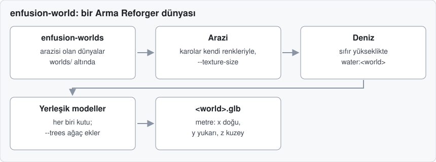

# Arma Reforger dünyaları: `enfusion-worlds` ve `enfusion-world` {#arma-reforger-worlds-enfusion-worlds-and-enfusion-world}

**Nedir?** Bir Arma Reforger dünyasının tek bir 3D dosya olarak hali. **Neden?** Oyundan gelen ısının, altında zemin ve binalar olsun diye. (*Enfusion*, Arma Reforger'ın yapıldığı motordur; *dünya*, oyunun harita dediği şeydir.)

Kurulu Arma Reforger'ın tam bir Enfusion dünyasını dışa aktarır: arazi, kendi süper doku karolarının renkleriyle; deniz; ve yerleştirilmiş her model bir kutu olarak, oyunun kendi metrelerinde.



## Adım adım {#step-by-step}

1. **Arazisi olan dünyaları listeleyin** (oyunun getirdiği):

   ```
   python -m heat3d_gamefiles enfusion-worlds
   python -m heat3d_gamefiles enfusion-worlds --install "D:\Games\Arma Reforger"
   ```

2. **Birini dışa aktarın**; `worlds/` altındaki klasör adıyla, listelendiği gibi:

   ```
   python -m heat3d_gamefiles enfusion-world <world> -o world.glb
   ```

3. **Varyasyonlar:**

   ```
   python -m heat3d_gamefiles enfusion-world <world> --trees               # vegetation too, as boxes
   python -m heat3d_gamefiles enfusion-world <world> --texture-size 0      # flat colour, small file
   python -m heat3d_gamefiles enfusion-world <world> --ground-spacing 4 --no-structures
   ```

4. **`world.glb` dosyasını açın** 3DHeat görüntüleyicisinin Arka plan / bölüm paneliyle ([bir seviye yükleme](https://holdi601.github.io/3DHeat/levels.html)).

## Seçenekler {#options}

| Seçenek | Varsayılan | Anlamı |
|---|---|---|
| `<world>` | zorunlu | `enfusion-worlds`'ün yazdığı gibi bir dünya |
| `-o`, `--out FILE` | `<world>.glb` (`$HEAT3D_LEVELS/<game>/` ayarlıysa orada) | yazılacak dosya |
| `--install FOLDER` | oyunu içeren Steam kütüphanesi | oyunun klasörü |
| `--ground-spacing METRES` | 2 (arazinin kendisi) | dosyadaki arazi tepe noktası aralığı |
| `--texture-size PIXELS` | 4096 | zemin renk görüntüsünün büyük kenarı; düz renk için 0 |
| `--no-structures` | | yerleştirilmiş modelleri dışarıda bırak |
| `--trees` | kapalı | ağaçları ve diğer bitkileri de kutular olarak yerleştir |

## Örnek çıktı {#example-output}

```text
<world> -> world.glb
  ground      <n> triangles, <w> x <h> m; <n> of <n> tile-edge vertices disagree; colour <w> x <h>
  structure   <n> boxes from <n> entities
  water       <n> triangles (the sea)
  left out    <what>: <n>, ...
```

## Parçalar {#the-parts}

`ground:<world>` (arazi), `water:<world>` (deniz, sıfır yükseklikte) ve `structure:<world>` (kutular). Koordinatlar oyunun kendisine aittir: x doğu, y yukarı, z kuzey, metre cinsinden; oyun içi bir kaydın bildirdiği gibi. Oyunun çerçevesi sol elli bir çerçevedir; görüntüleyicideki *invert world axis* seçeneği aynasız gösterir.

## Nasıl okunur ve denetlenir {#how-it-is-read-and-checked}

Workbench gerekmez ve hiçbir şey şifreli değildir.

| Biçim | Nedir | Neye karşı denetlenir |
|---|---|---|
| `.pak` | bir veri parçası ve bir dizin ağacı; girdiler saklı ya da zlib | ağaç parçasını tam olarak kullanır; örneklenen zlib girdileri tam bildirilen boyutlarına açılır |
| `.edds` | bir DDS başlığı, sonra mip düzeyi başına `COPY` ya da `LZ4 ` parçaları | parçalı düzeyler, tam olarak kendi baytlarını kullanarak tam boyutlarına çözülür |
| `.terr` / `.ttile` | bir başlık ve 16 bitlik yüksekliklerden oluşan karolar | paylaşılan her karo kenarı tam olarak eşleşir |
| süper doku | her karonun zemin rengi, metre başına yaklaşık bir piksel | yükseklikleriyle denizi eşleştirir; hiçbir ters çevirme ya da devrik eşleşme daha iyi uymaz |
| `.ent` | adlar, kaynak GUID'leri, sonra türlü değerler olarak varlıklar | bir dünya dosyası son baytına kadar ayrışır |
| `resourceDatabase.rdb` | GUID'den yola | bir dünyanın kullandığı neredeyse her GUID var olan bir dosyayı adlandırır |

Mutlak yükseklikte duran olarak işaretlenmiş nesneler, çözülmüş arazinin santimetreler içinde üstünde durur (ızgara devrik okunursa metrelerce kayar). Çizilmeyenler: modellerin kendi üçgenleri, varsayılan olarak ağaçlar (`--trees` bunları kutu olarak ekler), alt varlıklar, göller ve nehirler, DX10 öncesi başlıklı dokular.

**Terimler:** oyunun lisansı kişisel, ticari olmayan kullanıma izin verir ve oyun dosyalarının tersine mühendisliğini yasaklar. Kendi kurulumunuzu okumak, bu lisans altında sizin kararınızdır; çıktı yalnızca kendi kullanımınız içindir ve paylaşılmamalıdır.
