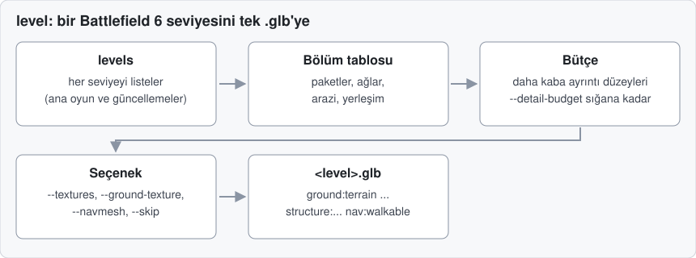

# Battlefield 6 seviyeleri: `levels` ve `level` {#battlefield-6-levels-levels-and-level}

**Nedir?** Bir Battlefield 6 seviyesinin tek bir 3D dosya olarak hali. **Neden?** Maçlarınızdan gelen ısının, altında zemin ve binalar olsun diye. (*Frostbite*, Battlefield'ın yapıldığı motordur; *yükseklik alanı*, zeminin yüksekliklerden oluşan bir ızgara olarak saklanmış halidir.)

Kurulu oyunun tam bir Frostbite seviyesini dışa aktarır: arazi yükseklik alanı, statik model gruplarının yerleştirdiği her mesh, tek tek yerleştirilmiş nesneler, haritanın çevresindeki arka plan arazisi ve isteğe bağlı olarak yüzeylerin renk haritaları, zemine pişirilmiş arazi çıkartmaları ve askerlerin yürüyebileceği yüzeyler.



## Adım adım {#step-by-step}

1. **Oyunun getirdiği seviyeleri listeleyin**:

   ```
   python -m heat3d_gamefiles levels
   python -m heat3d_gamefiles levels --install "D:\Games\<game folder>"
   ```

   Her satır bir seviye tablosudur (`levels/<level>/<level>.toc`); boyutu ve nereden geldiği yazılıdır: temel oyun için `Data`, bir güncelleme için `Update/<pack>`.

2. **Birini dışa aktarın**; adıyla, ya da bir parçasıyla, ya da `.toc` yoluyla. Şeklini ve boyutunu görmek için önce dokusuz başlayın:

   ```
   python -m heat3d_gamefiles level <level> -o level.glb
   ```

3. **Renk ekleyin**, her şey doğru göründüğünde:

   ```
   python -m heat3d_gamefiles level <level> -o level.glb --textures 512 --ground-texture 0.5
   ```

4. **Yürünebilir yüzeyleri ekleyin** ya da dosyayı küçültün:

   ```
   python -m heat3d_gamefiles level <level> --textures 512 --ground-texture 0.5 --navmesh
   python -m heat3d_gamefiles level <level> --textures 256 --detail-budget 3000000 --ground-spacing 8
   ```

5. **`level.glb` dosyasını açın** 3DHeat görüntüleyicisinin Arka plan / bölüm paneliyle ([bir seviye yükleme](https://holdi601.github.io/3DHeat/levels.html)).

## Seçenekler {#options}

| Seçenek | Varsayılan | Anlamı |
|---|---|---|
| `<level>` | zorunlu | `levels`'ın yazdığı bir ad, bir adın benzersiz bir parçası ya da bir seviyenin `.toc` dosyası |
| `-o`, `--out FILE` | `<level>.glb` (`$HEAT3D_LEVELS/<game>/` ayarlıysa orada) | yazılacak dosya |
| `--install FOLDER` | Steam kütüphanelerinde bulunur | oyunun klasörü |
| `--textures [PIXELS]` | kapalı; boyut verilmezse 512 | her yüzeyin renk haritası, en çok PIXELS kenar uzunluğunda |
| `--ground-texture [METRES]` | kapalı; boyut verilmezse 0.5 | yolları, pistleri ve çizgileri zeminin rengine pişir, METRES piksel başına |
| `--navmesh` | kapalı | asker gezinti ağını `nav:walkable` olarak ekle |
| `--ground-spacing METRES` | 4 | yükseklik alanının en ince aralığı; 0 ise dışarıda bırakır |
| `--detail-budget N` | en kaba kopyalar artı dörtte bir, en az 1.500.000 | üçgenler üzerinde bir tavan (arazi asla kabalaştırılmaz) |
| `--skip TEXT` | | adı TEXT içeren model gruplarını dışarıda bırak; tekrarlanabilir |
| `--by-mesh` | kapalı | her kaynak mesh ve malzeme için bir parça; bir parçanın ne olduğunu bulmak için |
| `--clamped-uvs` | kapalı | bir dokuyu tekrarlayamayan görüntüleyiciler için |

Tam tablo, beklenen boyutlarla (bir tam seviye yüzlerce MB'dir), [Komutlar](commands.md#levels-and-level-frostbite) sayfasındadır. Tabloların, paketlerin, mesh'lerin ve arazinin nasıl okunduğu [Frostbite](reader-frostbite.md) sayfasında anlatılır.

## Örnek çıktı {#example-output}

`level`'ın yazdıklarının özeti (kodun yazdığı satırlar; `<n>` ve adlar seviyeye göre değişir):

```text
<n> copies of <n> meshes, from <n> static model groups
      <n>  <group>
      <n>  placed one by one (object and prefab references)
<n> meshes left out: <why>
<n> triangles, budget <n>; <n> meshes drawn at a coarser level to fit
           <n>  ground:terrain
           <n>  structure:buildings, <n> textures
           ...
<n> of <n> drawn sections carry their colour map; the rest are flat colours
Ground: <what the ground is>.
Navigation mesh: <tiles read>.
-> level.glb (<n> MB)
```

## Parçalar {#the-parts}

`ground:terrain` (yükseklik alanı), `ground:terrain backdrop` ve `ground:terrain blend`, `structure:<kind>` her mesh türü için (`--textures` ile her renk haritası başına, bir maçta yok edilebilenler için ` (destructible)` ekiyle) ve `--navmesh` ile `nav:walkable`. Bkz. [Çıktı biçimi](output-format.md).

Dosya oyunun içeriğini barındırır: yaptığı makine için tasarlanmıştır, dolaştırılmak için değil ([Kurallar ve lisanslar](rules-and-licences.md)).
