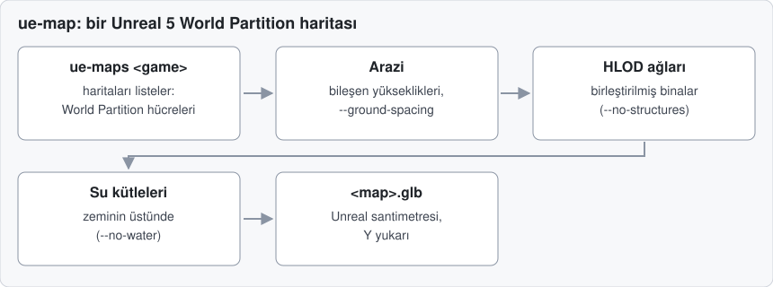

# Unreal 5 World Partition haritaları: `ue-maps` ve `ue-map` {#unreal-5-world-partition-maps-ue-maps-and-ue-map}

**Nedir?** Bir Unreal 5 oyununun tam bir haritasının tek bir 3D dosya olarak hali: zemin, binalar ve su. **Neden?** Bu oyundan gelen ısının, altında harita olsun diye. (*World Partition*, Unreal 5'in büyük bir haritayı parçalara bölme yöntemidir; *HLOD*, bir bina grubunun basitleştirilmiş yerine geçen, oyunun uzakta çizdiği modeldir.)

World Partition hücreleri olarak işlenmiş haritaları olan bir Unreal 5 oyununun tam bir haritasını dışa aktarır: arazi, haritanın birleştirilmiş HLOD mesh'leri (binaları ve nesneleri oyunun uzakta çizdiği haliyle) ve su gövdeleri. Bir editöre ya da projeye gerek yoktur; yalnızca kurulu oyun.



## Adım adım {#step-by-step}

1. **Haritaları listeleyin.** `<game>`, oyunun klasörü, `Content/Paks` klasörü ya da bir Steam kütüphanesindeki klasör adıdır:

   ```
   python -m heat3d_gamefiles ue-maps "<Steam game folder name>"
   python -m heat3d_gamefiles ue-maps "D:\Games\<game>"
   ```

   İşlenmiş World Partition hücreleri olan her harita, paket yoluyla birlikte yazılır.

2. **Birini dışa aktarın**, adıyla ya da bir parçasıyla:

   ```
   python -m heat3d_gamefiles ue-map "<game>" <map> -o map.glb
   ```

3. **Yalnızca zemin, ya da daha kaba:**

   ```
   python -m heat3d_gamefiles ue-map "<game>" <map> --no-structures --no-water
   python -m heat3d_gamefiles ue-map "<game>" <map> --ground-spacing 4
   ```

4. **`map.glb` dosyasını açın** 3DHeat görüntüleyicisinin Arka plan / bölüm paneliyle ([bir seviye yükleme](https://holdi601.github.io/3DHeat/levels.html)).

## Seçenekler {#options}

| Seçenek | Varsayılan | Anlamı |
|---|---|---|
| `<game>` | zorunlu | oyunun klasörü, `Content/Paks` klasörü ya da Steam klasör adı |
| `<map>` | zorunlu | `ue-maps`'in yazdığı bir ad ya da bir parçası |
| `-o`, `--out FILE` | `<map>.glb` (`$HEAT3D_LEVELS/<game>/` ayarlıysa orada) | yazılacak dosya |
| `--ground-spacing METRES` | 2 | arazinin tepe noktası aralığı; kendi dörtgenlerinin tam sayısına yuvarlanır |
| `--no-structures` | | HLOD binalarını ve nesnelerini dışarıda bırak |
| `--no-water` | | su gövdelerini dışarıda bırak |

Oodle ile sıkıştırılmış içerik, makinede zaten bulunan bir Oodle kütüphanesi gerektirir (bkz. [Oodle](reader-oodle.md)).

## Örnek çıktı {#example-output}

```text
<map> -> map.glb
  ground      <n> triangles from <n> landscape components; <n> of <n> vertices stored twice disagree
  structure   <n> triangles in <n> HLOD meshes
  water       <n> triangles from <n> water bodies
```

Uyuşmazlık sayısı bir kendi-kendini denetimdir: komşu arazi bileşenleri ortak kenarlarını iki kez saklar ve ikisi tam eşleşmelidir. 3 km'lik bir harita 2 m'de yaklaşık 4,6 milyon zemin üçgenidir.

## Parçalar {#the-parts}

`ground:<map>` (arazi), `structure:<map>` (HLOD mesh'leri) ve `water:<map>` (zeminin üstünde duran su).

**Birimler:** bu, metre olmayan tek dışa aktarımdır: Unreal santimetresi, Y ile Z yer değiştirmiş (Y yukarı); 3DHeat Unreal Exporter'ın yazdığı çerçeve. Aynı oyunun telemetrisi aynı çerçeveyi kullanır, bu yüzden haritanın üstüne oturur.

## Nasıl okunur ve denetlenir {#how-it-is-read-and-checked}

| Parça | Nereden okunur | Neye karşı denetlenir |
|---|---|---|
| zemin | her arazi bileşeninin 16 bitlik yükseklik haritası, arazinin dönüşümü üzerinde bölüm tabanıyla yerleştirilmiş | iki kez saklanan her tepe noktası (bir dikişte ya da bileşen kenarında) eşleşmelidir; uyuşmazlıklar sayılır ve yazılır, düzeltilmez |
| yapı | haritanın motor tarafından dünya uzayında kurulan birleştirilmiş HLOD mesh'leri | bir mesh, bileşeninin önbelleğe aldığı sınırlar kendi tepe noktalarını tanımlıyorsa tutulur |
| su | her su gövdesinin mesh'i, zemin ızgarasına serilmiş, zeminin üstünde durduğu yerde tutulur | su, nehrin yatağının üstünde olduğu gibi zeminin birkaç metre üstündedir |

Arazinin özellikleri yuva numarasıyla değil, şekle göre bulunur (yuvalar motor sürümleri arasında kayar). Yapılar, tam ayrıntılı modeller değil, basitleştirilmiş yerine geçenlerdir. Ot örtüsü, çıkartmalar ve arazi malzemeleri dışa aktarılmaz; zemin dokusuzdur ve görüntüleyici tarafından gölgelendirilir. Arşiv ayrıntıları: [Unreal 5 IoStore](reader-unreal-iostore.md).

**Terimler:** oyunların lisansları genellikle kişisel, ticari olmayan kullanıma izin verir ve "yasa tarafından yasaklanamayan ölçüde" tersine mühendisliği yasaklar. Kendi kurulumunuzu okumak bu lisanslar altında sizin kararınızdır; çıktı yalnızca kendi kullanımınız içindir ve paylaşılmamalıdır.
