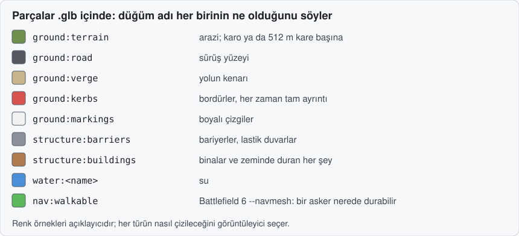

# Çıktı biçimi {#output-format}

Bir `.glb`, bir parkurun ya da bölümün zeminini, binalarını ve suyunu içeren tek bir 3D dosyasıdır. 3DHeat görüntüleyicisinin Arka plan / bölüm panelinde açılır.

Her dışa aktarma (`course`, `courses`, `terrain`, `level`, `ue-map`, `enfusion-world`) tek bir **binary glTF 2.0** dosyası (`.glb`) yazar. Bilerek küçük ve düz tutulmuştur ve 3DHeat görüntüleyicisinin bir bölümü okuduğu biçimde düzenlenmiştir. Kaynak:
[`glb.py`](https://github.com/Holdi601/3DHeat-GameFiles/blob/main/heat3d_gamefiles/glb.py).

## Yapı {#structure}

```
scene 0
 ├─ node "ground:terrain x-2046 z1023"  -> mesh 0 -> 1 primitive, material 0
 ├─ node "ground:road x-2046 z1023"     -> mesh 1 -> 1 primitive, material 1
 ├─ node "ground:markings"               -> mesh 2 -> ...
 ├─ node "ground:kerbs road_gen_rum_..." -> ...
 ├─ node "structure:barriers bar_armco_bclr"
 └─ ...
```

- **Her parça için bir node**, hepsi sahne kökünde, **dönüşümsüz**. Tüm geometri zaten dünya uzayındadır.
- Her node'un kendi mesh'i vardır: **tek primitive** ve kendi materyali. Node, mesh ve materyal parçanın adını taşır.
- Her primitive **kendi sıkı vertex dizilerine** sahiptir; yalnızca o parçanın kullandığı vertex'ler. Ortak bir vertex dizisi geçerli glTF'dir, ama her primitive'in erişimcilerini açan bir okuyucu, her vertex'i parça başına bir kez tutardı.
- `asset.generator` değeri `heat3d_gamefiles`'tır.
- **Az `extras`**, oyun ya da parkur adı yoktur:
  - Battlefield 6'da yıkılabilir bir mesh'in parçası, node'unda `{"destructible": true}` taşır;
  - Forza parkurunda `asset.extras` dosyanın ne içerdiğini söyler (biçim sürümü, eşleşen yarış kimliği, yarışın kendi katmanındaki kopya sayısı, mekânlar; bkz.
    [Forza Horizon parkurları](course-forza-horizon.md#writing-the-file)). Açılan parçalar katmanını node'unda taşır: yarışın kendi katmanı için `{"layer": "event", "route": <id>}`, başka bir açılan katman için `{"layer": "layer"}`, bir mekânın zemini için `{"layer": "venue"}`.

  Görüntüleyicinin ihtiyaç duyduğu diğer her şey node adlarındadır.

## Node adları: sınıflandırma {#node-names-the-classification}



Görüntüleyici bir parçanın sınıfını node adından alır (yoksa mesh adından) ve yalnızca adı şu desenle eşleşirse:

```
^(ground|structure|water)\s*[:|]
```

Diğer her ad, Unreal arazileri için yazılmış bir sezgisel kurala göre sınıflandırılır. Bu yüzden dışa aktarıcının yazdığı her parça bu öneklerden biriyle, ya da aşağıda anlatılan `nav:` ile başlar:

| Önek | Anlamı | Yazılan parçalar |
|---|---|---|
| `ground:` | sürüş yüzeyi ve arazi | `ground:road`, `ground:verge`, `ground:terrain`, `ground:gravel and dirt`, `ground:kerbs`, `ground:markings`, `ground:tyre marks`, `ground:venue`, `ground:plinths` |
| `structure:` | zeminin üstünde duran şeyler | `structure:barriers`, `structure:props`, `structure:signs`, `structure:buildings`, `structure:infrastructure`, `structure:bridges`, `structure:rocks`, `structure:smashables`, `structure:trees`; Forza katmanları `structure:event_<category>` ve `structure:layer_<category>` |
| `water:` | su | `water:water`; `water:<map>` (`ue-map`), `water:<world>` (`enfusion-world`) |
| `nav:` | Battlefield 6'da bir askerin yürüyebildiği yerler (yalnızca `--navmesh` ile) | `nav:walkable` |

`nav:` yukarıdaki görüntüleyici desenine uymaz, bu yüzden görüntüleyici onu sezgisel kuralıyla sıralar; ayrı bir parça olması, tek başına gösterilebilmesi ve gizlenebilmesi içindir. `ue-map` `ground:<map>`, `structure:<map>` ve `water:<map>` yazar; `enfusion-world` `ground:<world>`, `structure:<world>` ve `water:<world>` yazar.

Türden sonra oyuna göre şunlar gelir:

| Örnek | Anlamı |
|---|---|
| `ground:road x-2046 z1023` | Forza zemini, `x-2046 z1023` adlı arazi karesinde (ızgara birimi, 512 m başına 1023) |
| `ground:road 3_-2` | BeamNG zemini, 512 m'lik (3, -2) karesinde |
| `ground:road 3_-2 asphalt_light` | BeamNG'de o karedeki `asphalt_light` malzemesinin modellenmiş sürüş yüzeyi |
| `ground:road 1_-4` | AC Rally zemini, Unreal uzayında (1, -4) karesinde (512 m) |
| `structure:barriers bar_armco_bclr` | Aynı dokuyu paylaşan Forza yerleşik modelleri (adı, GUID'si olmadan) |
| `structure:barriers` | dokusuz yerleşik modeller (Forza, AC Rally) |
| `structure:event_barriers bar_example_bclr` | Forza: eşleşen yarışın, serbest dolaşım dünyasından ayrı kendi koyduğu şeyler (node extras `{"layer": "event", "route": <id>}`) |
| `structure:layer_props` | Forza: oyunun, bu yarış dışında bir şey için açtığı bir katman (bir etkinlik, bir toplanabilir, bir çalışma zamanı katmanı) |
| `ground:venue`, `ground:plinths` | Forza: zaten dünya koordinatlarında olan modeller: bir mekânın kendi zemini (bir stadyumun zemini) ve bir caddenin süslendiği zemin |
| `structure:barriers armco_metal` | BeamNG yerleşik modelleri, bir malzemeye göre |
| `ground:markings`, `water:water` | düz parçalar, dosya başına bir tane |
| `ground:terrain` (Battlefield 6) | yükseklik alanı; `ground:terrain backdrop` uzaktaki arazi mesh'leri, `ground:terrain blend` araziye karışan mesh'ler |
| `nav:walkable` (Battlefield 6, `--navmesh`) | bölümün asker için gezinme mesh'i: düz yeşil olarak, bir askerin durabildiği yerler |
| `ground:terrain x-512 z-512` (Battlefield 6, `--ground-texture`) | pişirilmiş tek bir decal karesinin altındaki yükseklik alanı; karenin alt köşesinin metre cinsinden koordinatıyla adlandırılır |
| `structure:buildings t_concreteclean_01_cs` (Battlefield 6, `--textures`) | o renk haritasını gösteren her yüzey; `--textures` olmadan tür başına bir parça, sonek yok |
| `structure:buildings t_concreteclean_01_cs (destructible)` (Battlefield 6) | aynısı, bir maçta yok edilebilen mesh'ler için: kendi adıyla bir yıkım varlığı olanlar (duvarlar, evler, eşyalar). Node ayrıca `{"destructible": true}` extras taşır. Yıkılmış halleri dışa aktarılmaz |

Görüntüleyici parçaları bu adlara göre süzebilir. Örneğin "yalnızca yarış yüzeyi", üç oyunda da `ground:road` ile `ground:kerbs` birlikte demektir; "yarışın kendi eşyaları olmadan dünya" ise `structure:event_*` dışındaki her şeydir. Önek, parçanın nasıl çizildiğini de belirler: zemin, ısının üstünde durduğu yüzey olarak; yapı ise o zeminin üstünde duran şey olarak.

## Birimler, eksenler ve çerçeve {#units-axes-and-frame}

- **Metre, Y yukarı**, glTF'nin kuralı; `ue-map` dışında her dışa aktarma için. Hiçbir şey yeniden ölçeklenmez ya da merkezi kaydırılmaz: sayılar oyunun dünya koordinatlarıdır. Asıl amaç da budur, arşivi okumak, bir şeyi yeniden kurmamak.
- **Unreal 5 haritaları (`ue-map`): santimetre**, Unreal'ın kendi birimi; Y ve Z yer değiştirmiş, böylece Y yukarıdır. Bu, 3DHeat Unreal Exporter'ın yazdığı ve oyunun telemetrisinin kullandığı çerçevedir. Metre olmayan tek dışa aktarma budur.
- **Arma Reforger (`enfusion-world`):** oyunun kendi metreleri; x doğu, y yukarı, z kuzey. Oyunun çerçevesi soldur; görüntüleyicinin *dünya eksenini ters çevir* seçeneği, ayna görüntüsü olmadan gösterir.
- **Forza:** oyunun kendi dünya koordinatları (x, y yukarı, z), değişmeden. Telemetrisiyle aynı, bu yüzden kaydedilmiş bir tur parkurun üstüne oturur.
- **BeamNG.drive:** BeamNG'nin Z-yukarı dünyasında `(x, z, -y)`; telemetri kaydedicisinin uyguladığı dönüşüm. Ayna değil, döndürme.
- **Battlefield 6:** oyunun kendi dünya koordinatları (x, y yukarı, z), değişmeden: her mesh'e bölümün örnek dönüşümleri, saklandığı gibi uygulanır. Aynalanmış kopyalar, normalleri dışarı bakacak şekilde yeniden sarılır.
- **Assetto Corsa Rally:** turun çerçevesi. Unreal santimetreleri metreye döner, Unreal Z'si y olur, Unreal X ve Y ise, turun oturduğu sekiz yönelimden hangisindeyse, x ve z olur (bkz.
  [Assetto Corsa Rally](course-assetto-corsa-rally.md#which-stage-and-which-way-round)). Bu eşleme ayna yapan yerlerde üçgenler yeniden sarılır.

Her dışa aktarma, telemetrisinin kullandığı eksenleri korur; böylece kayıt ile bölüm aynı çerçeveyi paylaşır. Çerçevenin her oyunda sol el mi sağ el mi olduğu kontrol edilmedi.

## Vertex verisi {#vertex-data}

Varsayılan biçim **kuantize** biçimdir (`quantize=True`). Bu, hem `extensionsUsed` hem de `extensionsRequired` içinde listelenen `KHR_mesh_quantization` uzantısını gerektirir.

| Öznitelik | Kuantize (varsayılan) | Tam hassasiyet (`quantize=False`) |
|---|---|---|
| `POSITION` | float32 VEC3, min/max ile | float32 VEC3 |
| `NORMAL` | int8 VEC3 normalleştirilmiş, 4 bayta doldurulmuş (adım 4) | float32 VEC3 |
| `TEXCOORD_0` (yalnızca dokulu parçalar) | uint16 VEC2 normalleştirilmiş, 0-1 aralığına kırpılmış; dokuların tekrar ettiği yerlerde (Battlefield 6) float32 VEC2 | float32 VEC2 |
| `COLOR_0` (dokusuz parçalar, bir parçada renk varsa) | uint8 VEC3 normalleştirilmiş, 4 bayta doldurulmuş | float32 VEC3 |
| indeksler | parça en fazla 65.535 vertex içeriyorsa uint16, değilse uint32 | uint32 |

Bir vertex 32 yerine 20 bayttır (renkle 44 yerine 24). Bu, her dosyadan üçte bir azaltır; bir şehir parkurunun bir tarayıcı sekmesinde yüklenmesiyle yüklenmemesi arasındaki farktır. Bedeli yarım dereceden az normal ve bir UV'nin 1/65.535'idir (4.096 pikselde bir texel'in on beşte biri). Komut satırı her zaman kuantize biçimi yazar. Python'da `write_glb(..., quantize=False)` diğerini yazar.

Normaller, oyunun sakladığı yerde oyundan gelir (Forza zemini ve modelleri, BeamNG şekilleri ve zemini). Aksi halde üçgenlerden alan ağırlıklı yumuşak normaller hesaplanır. AC Rally normalleri her zaman hesaplanır.

## Materyaller, renkler ve dokular {#materials-colours-and-textures}

- Her materyal `metallicFactor 0`, `roughnessFactor 1` değerindedir.
- **Dokulu parça:** parçanın görseliyle, UV'leriyle ve vertex rengi olmadan `baseColorTexture`. glTF ikisini çarpar; yüzey iki kez karartılmış olurdu.
- **Dokusuz parça:** parçanın düz rengiyle vertex rengi `COLOR_0` ve beyaz bir `baseColorFactor`. Dosyadaki hiçbir parçanın rengi yoksa `COLOR_0` yoktur. Parçalar vertex paylaştığında sonraki parçanın rengi kazanır; bu yüzden düz parçalar artan önem sırasıyla yazılır.
- **Görseller** ikili parçanın içine **JPEG** olarak gömülür; kalite 90, renk alt örneklemesi yok, yalnızca RGB (alfa atılır). Bunun istisnası, Battlefield 6'nın kesik maskelerinin (yapraklar, çitler) **PNG** olmasıdır; alfası ile birlikte, `alphaMode` MASK, `alphaCutoff` 0.5 ve `doubleSided` olan bir materyalde (bkz.
  [Frostbite](reader-frostbite.md#textures-and-materials)). 3DHeat görüntüleyicisi eşiğin altındaki texel'leri atar. Çimen ve ağaç tacı içeren 2.048 pikselli bir zemin, kayıpsız bir kodlayıcı için gürültüdür: PNG olarak bir karoda birkaç megabayt, JPEG olarak bir megabayttan az. Birden çok parçanın paylaştığı bir görsel bir kez saklanır.
- Tüm dokular için tek bir örnekleyici: büyütmede doğrusal, küçültmede doğrusal-mipmap-doğrusal, her iki eksende **kenara kenetleme**. Bu, dokuları yüzeylerini bir kez kaplayan parkur dışa aktarmaları içindir. BeamNG tekrar eden model dokularını düz renkle çizer (bkz.
  [BeamNG.drive](course-beamng.md#placed-models)).
- Dokuları tekrar eden bir Battlefield 6 dışa aktarması (`--textures`), oyunun kendi doku koordinatlarını, kırpılmadan, `TEXCOORD_0` olarak float32 biçiminde yazar; kuantize biçimde bile ve her iki eksende **tekrarlayan** bir örnekleyiciyle (`write_glb(..., repeat=True)`): bir tuğla duvar, UV'si 0'dan 40'a giden bir üçgen çiftidir. 3DHeat görüntüleyicisi böyle bir dokuyu kendi atlasının içinde sarar (bkz. görüntüleyicinin *Model seviyeleri* sayfası). Bir dokuyu tekrarlayamayan bir çizici için `level --clamped-uvs` (`write_level(..., clamped=True)`), her üçgeni dokusunun tekrar ettiği çizgiler boyunca keser ve her parçayı 0..1 aralığına taşır: aynı pikseller, aynı yüzey, yaklaşık beşte bir fazla üçgen. Doku üzerinde 16 kezden fazla tekrar eden üçgenler koordinatlarını korur. Dokusunun 4 parçadan fazlasına kesileceği bir üçgen (her dalı tekrarlayan kabuk; bu kesim bir ağacın 1.099 üçgenini 51.735'e çıkardı) kendi parçasına, `<part> (average colour)` adıyla, dokunun ortalama renginde gider; `level` kaç tane olduğunu söyler.

| Doku | Boyut | Neyi kaplar |
|---|---|---|
| zemin (Battlefield 6 dışındaki tüm oyunlar) | `--texture-size`: 2048, 1024 veya 512 piksel | bir 512 m'lik kare: piksel başına 25, 50 veya 100 cm |
| Battlefield 6 yükseklik alanı | bölümdeki arka plan renk haritasının en büyük mip'i, kırpılmış | arazi karesi: incelenen bölümde piksel başına 32 m |
| Battlefield 6 yüzeyleri | `--textures`: bir kenarda en fazla bu kadar piksel | yüzeyin kendi dokusu, parça başına bir kez (tekrar ettiği yerden kesilmiş) |
| Battlefield 6 pişirilmiş zemin | `--ground-texture`: piksel başına metre, en fazla 4.096 piksellik karolar | decal alanının bir karosu: 2.048 m, piksel başına 0,5 m |
| Forza yerleşik modeli | en fazla 256 piksel | modelin kendi UV düzeni |
| BeamNG yerleşik modeli | en fazla 256 piksel | modelin kendi UV düzeni, yalnızca tekrar etmediği yerlerde |
| AC Rally yerleşik modeli | yok | düz renkler |

## Yazıcının reddettikleri {#what-the-writer-refuses}

`write_glb`, bir görüntüleyicinin açıp yanlış göstereceği bir dosyayı yazmak yerine hata verir:

| Reddedilen | Neden |
|---|---|
| N x 3 olmayan ya da sonlu olmayan konumlar | bozuk bir mesh |
| vertex listesinin sonunu aşan bir indeks | gürültü olarak çizilir |
| UV'si olmayan dosyada dokulu bir parça | tek bir bulanık piksel olarak çizilir |
| hiç üçgen yok | hiçbir şey olarak çizilir |
| yanlış uzunlukta ya da sonlu olmayan bir normal, renk veya UV dizisi | vertex başına bir tane gerekir |

## Başka yerde okumak {#reading-it-elsewhere}

`KHR_mesh_quantization` destekleyen her glTF 2.0 görüntüleyici bu dosyaları açmalıdır. Yalnızca 3DHeat görüntüleyicisi denenmiştir; diğer görüntüleyiciler doğrulanmamıştır. Uzantıyı bilmeyen bir okuyucu dosyayı reddeder, çünkü dosya gerekli olarak işaretlidir. Dosyalar büyük olabilir: bir ülke parkuru için yaklaşık 80 MB, otomatik bütçeyle bir şehir parkuru için birkaç yüz MB'a kadar.

## 3DHeat'te {#in-3dheat}

[3DHeat](https://github.com/Holdi601/3DHeat) görüntüleyicisinin Arka plan / bölüm panelinde `.glb` dosyasını yükleyin; aynı oyunda kaydettiğiniz telemetri üstüne oturur, çünkü ikisi de oyunun koordinatlarını tutar. Görüntüleyicinin kendi belgeleri ([holdi601.github.io/3DHeat](https://holdi601.github.io/3DHeat/)) Arka plan / bölüm panelini ve diğer araçların yazdığı maç dosyalarını anlatır ([Bir maç için bir dosya: `.3dheat`](https://holdi601.github.io/3DHeat/container.html)). Bir bölüm her `.3dheat` dosyasında saklanmaz: bir maç onu `references` içinde (`kind: "level"`, ad ve sha256) adlandırır ve `.glb` maçların yanında durur.
