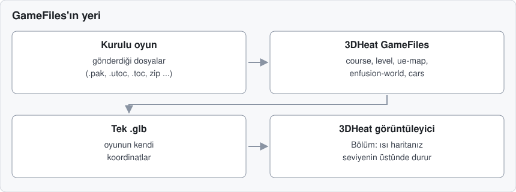

# Tüm seviyeler {#whole-levels}

**Basitçe:** turu olmayan nişancı ve diğer oyunlar için araç haritanın tamamını tek bir 3B dosya olarak kaydeder. Böylece görüntüleyici oyuncuların nerede dolaştığını çizebilir.

`course` bir turun etrafındaki zemini kırpar. Turu olmayan oyunlar için araç bir bütün seviyeyi, haritayı ya da dünyayı tek seferde dışa aktarır:

| Oyun ya da motor | Liste | Dışa aktarma | Sayfa |
|---|---|---|---|
| Battlefield 6 (Frostbite) | `levels` | `level <level>` | [Battlefield 6 seviyeleri](level-battlefield.md) |
| Unreal 5 World Partition oyunları | `ue-maps <game>` | `ue-map <game> <map>` | [Unreal 5 haritaları](level-unreal-world-partition.md) |
| Arma Reforger (Enfusion) | `enfusion-worlds` | `enfusion-world <world>` | [Arma Reforger dünyaları](level-arma-reforger.md) |

Her çift aynı şekilde çalışır. İlk komut, kurulu oyunun neleri tuttuğunu listeler. İkincisi bunlardan birini, oyunun kendi dünya koordinatlarında tek bir `.glb` olarak yazar. Böylece o oyunda kaydedilen konumlar üzerine oturur. Parçalar, diğer her dışa aktarmada olduğu gibi `ground:`, `structure:` ve `water:` olarak adlandırılır (bkz. [Çıktı biçimi](output-format.md)). Dosyayı 3DHeat görüntüleyicisinin **Arka plan / bölüm** panelinde yükleyin.

