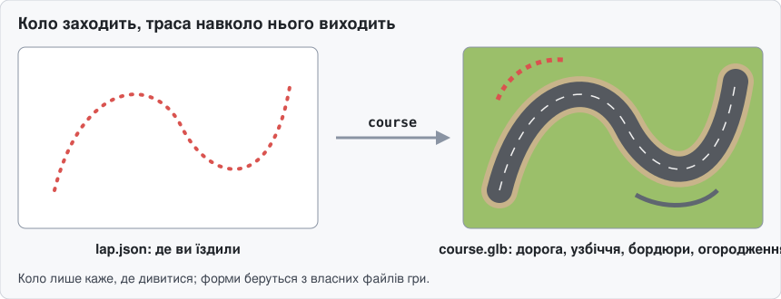
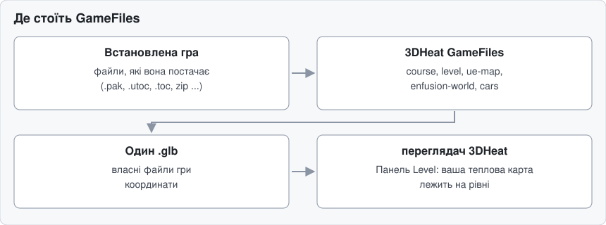

# 3DHeat GameFiles {#dheat-gamefiles}

**Що це?** Інструмент, який будує 3D-модель гоночної траси або рівня гри з файлів
гри, яку ви вже встановили.

**Навіщо це потрібно?** Переглядач 3DHeat малює, де ви їздили або грали, у вигляді
теплової карти. З цим інструментом він малює її на справжній трасі або рівні, а не в порожнечі.

**Приклад:** візьміть коло, яке ви проїхали. Інструмент будує дорогу і землю навколо
нього як один 3D-файл, тож переглядач може намалювати вашу швидкість чи аварії на
справжній трасі:



Ви лише починаєте працювати з командним рядком? Почніть із [Перш ніж почати](before-you-start.md).

Докладніше: інструмент читає дані рівня з архівів, які постачає гра, і записує їх
як двійковий glTF (файл `.glb`). Його головне завдання — **експорт траси**: ви даєте
йому коло, і він записує землю, дорогу (відокремлену від узбіччя і трави), а також
бордюри, огородження, шини-відбійники, знаки і будівлі навколо неї.

Він є частиною [3DHeat](https://github.com/Holdi601/3DHeat), переглядача телеметрії
реального часу у 3D, аналізу заїздів і огляду матчів
([документація](https://holdi601.github.io/3DHeat/)). Файли `.glb`, які записує цей
інструмент, — це рівні, на яких переглядач малює теплову карту.



Є три способи отримати геометрію рівня в 3DHeat:

| Спосіб | Потрібно | Дає |
|---|---|---|
| 3DHeat Unreal Exporter | проєкт Unreal, відкритий в редакторі | точну геометрію |
| 3DHeat GameCapture | екран і запис | приблизну оцінку |
| **3DHeat GameFiles** | **встановлена гра, як її постачають** | **точну геометрію, без проєкту** |

Пакет Python: `heat3d_gamefiles`. Репозиторій:
[Holdi601/3DHeat-GameFiles](https://github.com/Holdi601/3DHeat-GameFiles). Ліцензія: MIT.

## Що вміє {#what-it-can-do}

| Гра або рушій | Експорт траси (`course`) | Читання архівів |
|---|---|---|
| Forza Horizon (ForzaTech) | так: рельєф, дорога і узбіччя, текстура землі, розміщені моделі у власних текстурах | `identify`, `list`, `extract` для `.minizip`; `identify` для `.modelbin`; моделі, рельєф і текстури через `course` і `terrain` |
| BeamNG.drive | так: рельєф, декали доріг, змодельовані траси, розміщені моделі, вода | `identify`, `list`, `extract` для zip-архівів рівнів; `identify` для `.ter`, `.cdae`; `.dae` через `course` |
| Assetto Corsa Rally (Unreal 5.6) | так: плитки землі етапу, запечений колір землі, розміщені моделі в плоских кольорах | `identify`, `list`, `extract` для IoStore `.utoc`/`.ucas`; пакети zen, статичні сітки, текстури через `course` |
| Unreal `.pak` (версії 8-12) | ні | `identify`, `list`, `extract` |
| Unity (формат 22 і новіші) | ні | `identify`, `meshes` |
| Battlefield 6 (Frostbite `.toc`/`.cas`) | немає кола; весь рівень через `level`: рельєф, розміщені сітки, їхні кольорові карти з `--textures` | `identify`, `levels`; пакети, сітки, рельєф, текстури і розміщення через `level` |
| Source 2 `.vpk` | ні | `identify`, `list`, `extract` |
| Ігри Unreal 5 з World Partition | немає кола; вся карта через `ue-map` (перелічені через `ue-maps`): ландшафт, будівлі й реквізит HLOD, вода | - |
| Arma Reforger (Enfusion) | немає кола; увесь світ через `enfusion-world` (перелічений через `enfusion-worlds`): рельєф у його кольорах, море, будівлі коробками | - |
| Forza (автомобілі) | `cars`: кожен автомобіль у низькій деталізації для вкладки «Аналіз заїздів» переглядача | - |

Кола з Assetto Corsa EVO та iRacing відхиляються з поясненням причини. Див.
[Обмеження і відомі прогалини](../limits-and-known-gaps.md).

## Встановлення {#install}

Ви лише починаєте працювати з командним рядком? Спершу прочитайте [Перш ніж почати](before-you-start.md).

Вам потрібен **Python 3.10 або новіший** (розроблено на 3.13) і пакети з
[`requirements.txt`](https://github.com/Holdi601/3DHeat-GameFiles/blob/main/requirements.txt).

```
git clone https://github.com/Holdi601/3DHeat-GameFiles.git
cd 3DHeat-GameFiles
pip install -r requirements.txt
```

Потім перевірте: `python -m heat3d_gamefiles --help`. Ви маєте побачити
`usage: heat3d_gamefiles [-h]` і список команд. Виконуйте кожну команду з папки
репозиторію, як `python -m heat3d_gamefiles <verb>`.

| Пакет | Для чого |
|---|---|
| numpy | усе, що декодує геометрію |
| lz4 | архіви Forza (здебільшого блоки LZ4), деякі пакети Unity, блоки LZ4 IoStore |
| Pillow | декодування текстур BC1-BC7, запис текстур JPEG у `.glb` |
| msgpack, zstandard | скомпільовані форми BeamNG (`.cdae`) |
| cryptography | лише для відкриття зашифрованого `.pak` ключем, який у вас уже є |
| pytest | тести |

Вміст Unreal, стиснутий за допомогою **Oodle**, потребує бібліотеки Oodle, яка вже є
на вашому комп'ютері. Цей інструмент її ніколи не постачає. Див. [Oodle](../reader-oodle.md).

Інструмент написано для Windows. Він знаходить ігри через список бібліотек Steam і
`%LOCALAPPDATA%`, а Oodle завантажує як DLL Windows. Інші платформи не перевірялися.

## Швидкий старт {#quick-start}

**Файл кола** — це запис того, куди поїхала ваша машина: список точок x, y, z.
Він походить із [3DHeat GameCapture](https://github.com/Holdi601/3DHeat-GameCapture)
або з бібліотеки кіл застосунку FH Companion; CSV, введений вручну, теж підходить
([Вхідні дані кола](../lap-inputs.md)).

```
# Forza: файл кола, папка кіл або назва траси з бібліотеки FH Companion
python -m heat3d_gamefiles course "Example Circuit"
python -m heat3d_gamefiles course path\to\lap.json -o course.glb

# BeamNG.drive або Assetto Corsa Rally: файл heat3d-lap каже, з якої він гри
python -m heat3d_gamefiles course my_lap.json

# Кожна траса з бібліотеки FH Companion, по одному .glb на кожну
python -m heat3d_gamefiles courses -o courses

# Battlefield 6: спершу перелічіть рівні, потім експортуйте один (великий файл; див. Команди)
python -m heat3d_gamefiles levels
python -m heat3d_gamefiles level <level> -o level.glb --textures

# Unreal 5 World Partition і Arma Reforger: переліч, потім експорт
python -m heat3d_gamefiles ue-maps "<game>"
python -m heat3d_gamefiles ue-map "<game>" <map> -o map.glb
python -m heat3d_gamefiles enfusion-worlds
python -m heat3d_gamefiles enfusion-world <world> -o world.glb

# Кожен автомобіль Forza для вкладки «Аналіз заїздів» переглядача
python -m heat3d_gamefiles cars -o forza.h3dcars

# Що це за файл?
python -m heat3d_gamefiles identify some_archive.pak
```

Відкрийте `.glb` у переглядачі 3DHeat. Світові координати самої гри зберігаються (див.
[Формат виводу](../output-format.md)), тож записане коло збігається з трасою.

## Карта цієї документації {#map-of-this-documentation}

- [Перш ніж почати](before-you-start.md): Python, термінал, перша команда.
- [Команди](../commands.md): кожна команда і кожен параметр, із прикладами.
- [Довідка з команд](../cli-reference.md): `--help` кожної команди, створений з коду.
- [Перегляд архівів](../inspecting-archives.md): `identify`, `list`, `extract`, `meshes`, крок за кроком.
- [Експорт траси](../course-export.md): як коло стає трасою, для всіх ігор.
  - [Forza Horizon](../course-forza-horizon.md)
  - [BeamNG.drive](../course-beamng.md)
  - [Assetto Corsa Rally](../course-assetto-corsa-rally.md)
  - [Рівні деталізації і бюджет](../detail-budget.md)
- [Цілі рівні](../whole-levels.md): рівень, карта або світ без кола.
  - [Рівні Battlefield 6](../level-battlefield.md): `levels`, `level`
  - [Карти Unreal 5](../level-unreal-world-partition.md): `ue-maps`, `ue-map`
  - [Світи Arma Reforger](../level-arma-reforger.md): `enfusion-worlds`, `enfusion-world`
- [Автомобілі Forza](../forza-cars.md): `cars`, файл автомобілів для вкладки «Аналіз заїздів» переглядача.
- [Вхідні дані кола](../lap-inputs.md): кожна форма файлу кола, яку приймає інструмент.
- [Формат виводу](../output-format.md): що всередині `.glb`.
- [Читачі архівів](../archive-readers.md): по одній сторінці на кожен формат контейнера,
  що читає кожен, що не читає, і чому.
- [Обмеження і відомі прогалини](../limits-and-known-gaps.md)
- [Усунення несправностей](../troubleshooting.md): повідомлення про помилки і що з ними робити.
- [Правила і ліцензії](../rules-and-licences.md): без ключів, ваші власні файли, без передачі далі.
- [Оновлення](../updates.md): перевірка оновлень і `heat3d_update`.
- [Розробка](../development.md): карта модулів і тести, зокрема тести, що працюють з встановленими іграми.
- [Підтримка](../maintaining.md): контрольний список випуску для цих сторінок.

## Частина 3DHeat {#part-of-3dheat}

3DHeat GameFiles — один з безкоштовних інструментів навколо переглядача 3DHeat:

| Інструмент | Що робить | Документація |
|---|---|---|
| [3DHeat](https://github.com/Holdi601/3DHeat) | переглядач: 3D-теплові карти, аналіз заїздів і огляд матчів у браузері | [сайт](https://holdi601.github.io/3DHeat/) |
| [GameFiles](https://github.com/Holdi601/3DHeat-GameFiles) | траси і рівні з файлів, які постачають ігри, як `.glb` | [сайт](https://holdi601.github.io/3DHeat-GameFiles/) |
| [GameCapture](https://github.com/Holdi601/3DHeat-GameCapture) | телеметрія кіл з гоночних ігор; рівні, відтворені з відео ігрового процесу | [сайт](https://holdi601.github.io/3DHeat-GameCapture/) |
| [Unreal Exporter](https://github.com/Holdi601/3DHeat-UnrealExporter) | плагін для Unreal Editor, який зберігає рівень як `.glb` | [сайт](https://holdi601.github.io/3DHeat-UnrealExporter/) |
| [CS2](https://github.com/Holdi601/3DHeat-CS2) | демо Counter-Strike 2 у файли матчів; карти в `.glb` | [сайт](https://holdi601.github.io/3DHeat-CS2/) |
| [Watcher](https://github.com/Holdi601/3DHeat-Watcher) | записує вашу гру у фоновому режимі з того, що публікують ігри | [сайт](https://holdi601.github.io/3DHeat-Watcher/) |
| [Ext-WarThunder](https://github.com/Holdi601/3DHeat-Ext-WarThunder) | повтори War Thunder у файли матчів | [сайт](https://holdi601.github.io/3DHeat-Ext-WarThunder/) |
| [Ext-WoT](https://github.com/Holdi601/3DHeat-Ext-WoT) | повтори World of Tanks у файли матчів | [сайт](https://holdi601.github.io/3DHeat-Ext-WoT/) |
| [Ext-WoWs](https://github.com/Holdi601/3DHeat-Ext-WoWs) | повтори World of Warships у файли матчів | [сайт](https://holdi601.github.io/3DHeat-Ext-WoWs/) |
| [Ext-Squad](https://github.com/Holdi601/3DHeat-Ext-Squad) | демо серверів Squad у файли матчів | [сайт](https://holdi601.github.io/3DHeat-Ext-Squad/) |
| [Ext-DCS](https://github.com/Holdi601/3DHeat-Ext-DCS) | карти DCS World у `.glb`-рівні | [сайт](https://holdi601.github.io/3DHeat-Ext-DCS/) |
| [Ext-IL2](https://github.com/Holdi601/3DHeat-Ext-IL2) | карти IL-2 Sturmovik у `.glb`-рівні | [сайт](https://holdi601.github.io/3DHeat-Ext-IL2/) |

Файли матчів переглядача описано в
[Один файл на матч: `.3dheat`](https://holdi601.github.io/3DHeat/container.html);
рівень, зроблений тут, завантажується поруч із ними в панелі «Тло / рівень» переглядача.
