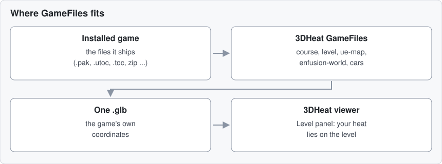

# Whole levels

`course` cuts the ground around a lap. For games without laps the tool exports
a whole level, map or world at once:

| Game or engine | List | Export | Page |
|---|---|---|---|
| Battlefield 6 (Frostbite) | `levels` | `level <level>` | [Battlefield 6 levels](level-battlefield.md) |
| Unreal 5 World Partition games | `ue-maps <game>` | `ue-map <game> <map>` | [Unreal 5 maps](level-unreal-world-partition.md) |
| Arma Reforger (Enfusion) | `enfusion-worlds` | `enfusion-world <world>` | [Arma Reforger worlds](level-arma-reforger.md) |

Each pair works the same way: the first verb lists what the installed game
holds, the second writes one of them as a single `.glb` in the game's own
world coordinates, so positions recorded in that game lie on it. The parts are
named `ground:`, `structure:` and `water:` like every other export (see
[Output format](output-format.md)); load the file in the 3DHeat viewer's Level
panel.

