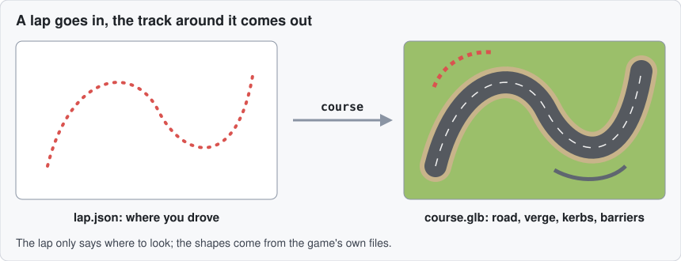
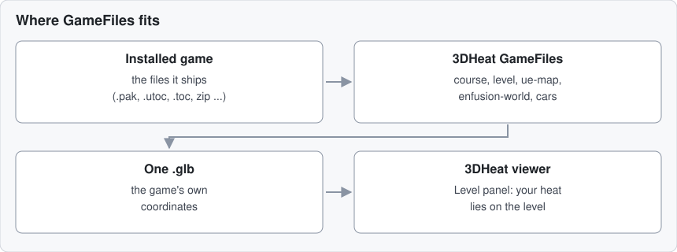

# 3DHeat GameFiles

**What is it?** A tool that builds a 3D model of a race track or a game level
from the files of a game you already have installed.

**Why would I use it?** The 3DHeat viewer paints where you drove or played as
heat. With this tool it paints it on the real track or level, not on empty space.

**Example:** take a lap you drove. The tool builds the road and land around it
as one 3D file, so the viewer can paint your speed or crashes on the real track:



New to the command line? Start with [Before you start](before-you-start).

In more detail: it reads level data out of the archives a game ships and writes
it as a binary glTF (`.glb`) file. Its main job is the **course export**: you
give it a lap, and it writes the ground, the road told apart from verge and
grass, and the kerbs, barriers, tyre walls, signs and buildings around it.

It is part of [3DHeat](https://github.com/Holdi601/3DHeat), a viewer for
realtime 3D telemetry heatmaps, race analysis and match review
([documentation](https://holdi601.github.io/3DHeat/)). The `.glb` files this
tool writes are the levels the viewer draws the heat on.



It is one of three ways to get a level's geometry into 3DHeat:

| Route | Needs | Gives |
|---|---|---|
| 3DHeat Unreal Exporter | the Unreal project open in the editor | exact geometry |
| 3DHeat GameCapture | a screen and a capture | an estimate |
| **3DHeat GameFiles** | **the installed, shipped game** | **exact geometry, no project** |

Python package: `heat3d_gamefiles`. Repository:
[Holdi601/3DHeat-GameFiles](https://github.com/Holdi601/3DHeat-GameFiles). Licence: MIT.


## The games' own readers

Each game reader is its own small project with its own licence file, releases and
issue tracker, so it can be installed, updated, maintained - or withdrawn on a
rights holder's request - on its own, without affecting the viewer or the other
tools. Install the one for your game (its page says how), and both its own
command and the verbs here work. GameFiles runs the game's tool with the
arguments you gave it; nothing of the tool is imported. It is found as its
command on `PATH`, as its installed package, or as its folder in
`HEAT3D_<GAME>_MAPS` or beside GameFiles (`exporters/ext/<game>-maps` in a 3DHeat
checkout, or `3DHeat-Ext-<Game>` next to this folder). When it is not installed,
the verb says where to get it and exits with code 2.

| Game | Its own tool | Verbs here that run it |
|---|---|---|
| Forza Horizon / Motorsport | [3DHeat-Ext-Forza](https://holdi601.github.io/3DHeat-Ext-Forza/) (`heat3d-forza-maps`) | `course` (Forza laps), `courses`, `races`, `cars`, `terrain`; `identify`, `list`, `extract` of a `.minizip` |
| Battlefield (Frostbite) | [3DHeat-Ext-Battlefield](https://holdi601.github.io/3DHeat-Ext-Battlefield/) (`heat3d-battlefield-maps`) | `levels`, `level`; `identify` of a Frostbite `.toc` |
| BeamNG.drive | [3DHeat-Ext-BeamNG](https://holdi601.github.io/3DHeat-Ext-BeamNG/) (`heat3d-beamng-maps`) | `course` (BeamNG laps); `identify` of a `.cdae` or `.ter` |
| Assetto Corsa Rally | [3DHeat-Ext-ACRally](https://holdi601.github.io/3DHeat-Ext-ACRally/) (`heat3d-acrally-maps`) | `course` (AC Rally laps) |
| Arma Reforger (Enfusion) | [3DHeat-Ext-Reforger](https://holdi601.github.io/3DHeat-Ext-Reforger/) (`heat3d-reforger-maps`) | `enfusion-worlds`, `enfusion-world` |

## What it can do

| Game or engine | Course export (`course`) | Archive reading |
|---|---|---|
| Forza Horizon (ForzaTech) | yes: terrain, road and verge, ground texture, placed models in their own textures | `identify`, `list`, `extract` on a `.minizip`; `identify` on a `.modelbin`; models, terrain and textures through `course` and `terrain` |
| BeamNG.drive | yes: terrain, road decals, modelled circuits, placed models, water | `identify`, `list`, `extract` on level zips; `identify` on `.ter`, `.cdae`; `.dae` through `course` |
| Assetto Corsa Rally (Unreal 5.6) | yes: stage ground tiles, baked ground colour, placed models in flat colours | `identify`, `list`, `extract` on IoStore `.utoc`/`.ucas`; zen packages, static meshes, textures through `course` |
| Unreal `.pak` (versions 8-12) | no | `identify`, `list`, `extract` |
| Unity (format 22 and later) | no | `identify`, `meshes` |
| Battlefield 6 (Frostbite `.toc`/`.cas`) | no lap; a whole level with `level`: terrain, placed meshes, their colour maps with `--textures` | `identify`, `levels`; bundles, meshes, terrain, textures and placement through `level` |
| Source 2 `.vpk` | no | `identify`, `list`, `extract` |
| Unreal 5 World Partition games | no lap; a whole map with `ue-map` (listed by `ue-maps`): landscape, HLOD buildings and props, water | - |
| Arma Reforger (Enfusion) | no lap; a whole world with `enfusion-world` (listed by `enfusion-worlds`): terrain in its colours, the sea, buildings as boxes | - |
| Forza (cars) | `cars`: every car at low detail, for the viewer's Race analysis tab | - |

Laps from Assetto Corsa EVO and iRacing are refused with a reason. See
[Limits and known gaps](limits-and-known-gaps).

## Install

New to the command line? Read [Before you start](before-you-start) first.

You need **Python 3.10 or later** (developed on 3.13) and the packages in
[`requirements.txt`](https://github.com/Holdi601/3DHeat-GameFiles/blob/main/requirements.txt).

```
git clone https://github.com/Holdi601/3DHeat-GameFiles.git
cd 3DHeat-GameFiles
pip install -r requirements.txt
```

Then check it: `python -m heat3d_gamefiles --help`. You should see
`usage: heat3d_gamefiles [-h]` and the list of verbs. Run every command from the
repository folder, as `python -m heat3d_gamefiles <verb>`.

| Package | Used for |
|---|---|
| numpy | everything that decodes geometry |
| lz4 | Forza archives (mostly LZ4 blocks), some Unity bundles, IoStore LZ4 blocks |
| Pillow | decoding BC1-BC7 textures, writing the JPEG textures in the `.glb` |
| msgpack, zstandard | BeamNG's compiled shapes (`.cdae`) |
| cryptography | only for opening an encrypted `.pak` with a key you already hold |
| pytest | the tests |

Unreal content compressed with **Oodle** needs an Oodle library that is already
on your machine. One is never shipped with this tool. See [Oodle](reader-oodle).

The tool is written for Windows. It finds games through Steam's library list and
`%LOCALAPPDATA%`, and loads Oodle as a Windows DLL. Other platforms have not been
tested.

## Quick start

Most people never install GameFiles by hand: each game's tool
([The games' own readers](#the-games-own-readers)) brings it when you install
that tool, so start with the tool for your game. On its own, GameFiles reads
the engines' archives and exports Unreal 5 World Partition maps.

You need Windows, Python 3.10 or later ("Add python.exe to PATH" ticked in its
installer) and the game installed; no Git. Unreal content is mostly
Oodle-compressed: an `oo2core_*_win64.dll` that an installed Unreal game ships
is found by itself, or `HEAT3D_OODLE` names one ([Oodle](reader-oodle)).
New to the command line? Read [Before you start](before-you-start) first.

```bash
python -m pip install https://github.com/Holdi601/3DHeat-GameFiles/archive/refs/tags/v1.1.0.zip
heat3d-gamefiles ue-maps "<Steam game folder name>"                 # an Unreal 5 game's World Partition maps
heat3d-gamefiles ue-map "<Steam game folder name>" <map> -o map.glb  # one of them as a level
heat3d-gamefiles identify <file>                                    # what a game file is
```

The game is named by its Steam folder name or by its folder. `map.glb` lands
in the folder you ran it in (without `-o`, `<map>.glb`). `heat3d-gamefiles --help`
lists every verb; the game verbs (`course`, `courses`, `cars`, `level`,
`enfusion-world`, ...) run the game's own tool with the same arguments when it
is installed, and say where to get it when it is not. The game's own world
coordinates are kept (see [Output format](output-format)), so a recorded lap
lines up with the course.

Then open the `.glb` in the [3DHeat viewer](https://github.com/Holdi601/3DHeat#quick-start):
download it (**Code -> Download ZIP**, unpack), double-click `start.bat` (it
offers to install Node.js when it is missing and opens `http://127.0.0.1:5273`),
then **Background / level -> 3D model...** and pick the file.

A game tool that updates itself brings the GameFiles release it needs.
Installed on its own like this, GameFiles does not check for updates: run the
install line again with the newer release's number from
[Releases](https://github.com/Holdi601/3DHeat-GameFiles/releases).

## Map of this documentation

- [Before you start](before-you-start): Python, a terminal, the first command.
- [Commands](commands): every verb and option, with examples.
- [Command reference](cli-reference): every verb's `--help`, generated from the code.
- [Inspecting archives](inspecting-archives): `identify`, `list`, `extract`, `meshes`, step by step.
- [Course export](https://holdi601.github.io/3DHeat-Ext-Forza/course-export.html): how a lap becomes a course, for all games.
  - [Forza Horizon](https://holdi601.github.io/3DHeat-Ext-Forza/course-forza-horizon.html)
  - [BeamNG.drive](https://holdi601.github.io/3DHeat-Ext-BeamNG/course-beamng.html)
  - [Assetto Corsa Rally](https://holdi601.github.io/3DHeat-Ext-ACRally/course-assetto-corsa-rally.html)
  - [Levels of detail and the budget](detail-budget)
- [Whole levels](whole-levels): a level, map or world without a lap.
  - [Battlefield 6 levels](https://holdi601.github.io/3DHeat-Ext-Battlefield/level-battlefield.html): `levels`, `level`
  - [Unreal 5 maps](level-unreal-world-partition): `ue-maps`, `ue-map`
  - [Arma Reforger worlds](https://holdi601.github.io/3DHeat-Ext-Reforger/level-arma-reforger.html): `enfusion-worlds`, `enfusion-world`
- [Forza cars](https://holdi601.github.io/3DHeat-Ext-Forza/forza-cars.html): `cars`, the car file for the viewer's race tab.
- [Lap inputs](lap-inputs): every lap file shape the tool accepts.
- [Output format](output-format): what is inside the `.glb`.
- [Archive readers](archive-readers): one page per container format, covering
  what each reads, what it does not, and why.
- [Limits and known gaps](limits-and-known-gaps)
- [Troubleshooting](troubleshooting): the error messages and what to do.
- [Rules and licences](rules-and-licences): no keys, your own files, no redistribution.
- [Updates](updates): the update check and `heat3d_update`.
- [Development](development): module map and tests, including the tests that run against installed games.
- [Maintaining](maintaining): the release checklist for these pages.

## Part of 3DHeat

3DHeat GameFiles is one of the free tools around the 3DHeat viewer:

| Tool | What it does | Docs |
|---|---|---|
| [3DHeat](https://github.com/Holdi601/3DHeat) | the viewer: 3D heatmaps, race analysis and match review in the browser | [site](https://holdi601.github.io/3DHeat/) |
| [GameFiles](https://github.com/Holdi601/3DHeat-GameFiles) | courses and levels out of the files a game ships, as `.glb` | [site](https://holdi601.github.io/3DHeat-GameFiles/) |
| [GameCapture](https://github.com/Holdi601/3DHeat-GameCapture) | lap telemetry from racing games; levels rebuilt from gameplay video | [site](https://holdi601.github.io/3DHeat-GameCapture/) |
| [Unreal Exporter](https://github.com/Holdi601/3DHeat-UnrealExporter) | an Unreal Editor plugin that saves a level as `.glb` | [site](https://holdi601.github.io/3DHeat-UnrealExporter/) |
| [CS2](https://github.com/Holdi601/3DHeat-CS2) | Counter-Strike 2 demos into match files; maps into `.glb` | [site](https://holdi601.github.io/3DHeat-CS2/) |
| [Watcher](https://github.com/Holdi601/3DHeat-Watcher) | records your play in the background from what games publish | [site](https://holdi601.github.io/3DHeat-Watcher/) |
| [Ext-WarThunder](https://github.com/Holdi601/3DHeat-Ext-WarThunder) | War Thunder replays into match files | [site](https://holdi601.github.io/3DHeat-Ext-WarThunder/) |
| [Ext-WoT](https://github.com/Holdi601/3DHeat-Ext-WoT) | World of Tanks replays into match files | [site](https://holdi601.github.io/3DHeat-Ext-WoT/) |
| [Ext-WoWs](https://github.com/Holdi601/3DHeat-Ext-WoWs) | World of Warships replays into match files | [site](https://holdi601.github.io/3DHeat-Ext-WoWs/) |
| [Ext-Squad](https://github.com/Holdi601/3DHeat-Ext-Squad) | Squad server demos into match files | [site](https://holdi601.github.io/3DHeat-Ext-Squad/) |
| [Ext-DCS](https://github.com/Holdi601/3DHeat-Ext-DCS) | DCS World maps into `.glb` levels | [site](https://holdi601.github.io/3DHeat-Ext-DCS/) |
| [Ext-IL2](https://github.com/Holdi601/3DHeat-Ext-IL2) | IL-2 Sturmovik maps into `.glb` levels | [site](https://holdi601.github.io/3DHeat-Ext-IL2/) |
| [Ext-Dota](https://github.com/Holdi601/3DHeat-Ext-Dota) | the Dota 2 map from your own install as a 3D level | [site](https://holdi601.github.io/3DHeat-Ext-Dota/) |
| [Ext-DotaReplay](https://github.com/Holdi601/3DHeat-Ext-DotaReplay) | Dota 2 replays | [site](https://holdi601.github.io/3DHeat-Ext-DotaReplay/) |
| [Ext-Riot](https://github.com/Holdi601/3DHeat-Ext-Riot) | League of Legends and VALORANT replays (what they carry unencrypted) | [site](https://holdi601.github.io/3DHeat-Ext-Riot/) |
| [Ext-Forza](https://github.com/Holdi601/3DHeat-Ext-Forza) | Forza courses, races and cars from your own install | [site](https://holdi601.github.io/3DHeat-Ext-Forza/) |
| [Ext-Battlefield](https://github.com/Holdi601/3DHeat-Ext-Battlefield) | Battlefield levels (Frostbite) as 3D levels | [site](https://holdi601.github.io/3DHeat-Ext-Battlefield/) |
| [Ext-BeamNG](https://github.com/Holdi601/3DHeat-Ext-BeamNG) | BeamNG.drive courses | [site](https://holdi601.github.io/3DHeat-Ext-BeamNG/) |
| [Ext-ACRally](https://github.com/Holdi601/3DHeat-Ext-ACRally) | Assetto Corsa Rally stages as courses | [site](https://holdi601.github.io/3DHeat-Ext-ACRally/) |
| [Ext-Reforger](https://github.com/Holdi601/3DHeat-Ext-Reforger) | Arma Reforger worlds (Enfusion) as 3D levels | [site](https://holdi601.github.io/3DHeat-Ext-Reforger/) |
| [Ext-R6](https://github.com/Holdi601/3DHeat-Ext-R6) | Rainbow Six Siege match replays | [site](https://holdi601.github.io/3DHeat-Ext-R6/) |

The viewer's match files are described in
[One file a match: `.3dheat`](https://holdi601.github.io/3DHeat/container.html);
a level made here is loaded beside them in the viewer's Background / level panel.
