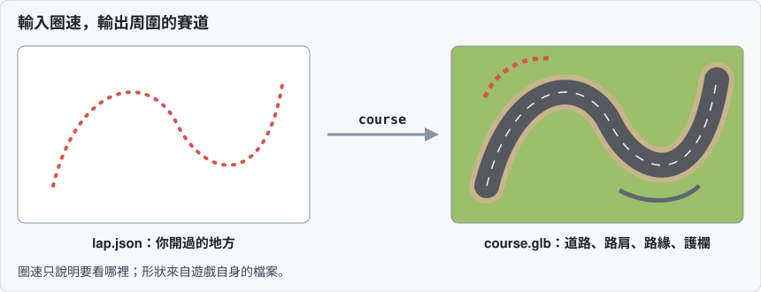
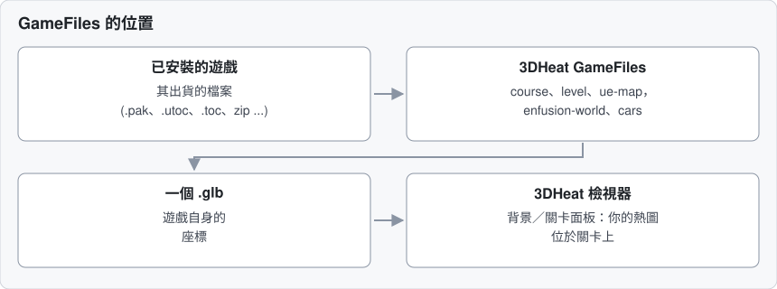

# 3DHeat GameFiles {#dheat-gamefiles}

**這是什麼？** 一個工具，能從你已安裝遊戲的檔案中，建立賽道或遊戲關卡的 3D 模型。

**為什麼要用它？** 3DHeat 檢視器會把你開過或玩過的地方，畫成熱圖。有了這個工具，熱圖就會畫在真實的賽道或關卡上，而不是空白的空間中。

**範例：** 取一圈你開過的圈速。工具會把它周圍的道路與地面，建成一個 3D 檔案，這樣檢視器就能把你的速度或撞擊畫在真實的賽道上：



第一次使用命令列？請先從[開始之前](before-you-start.md)開始。

更詳細地說：它會從遊戲隨附的封存檔中讀取關卡資料，並寫成二進位 glTF（`.glb`）檔。它的主要工作是**賽道匯出**：你給它一圈圈速，它就會寫出地面、區分出來的道路與路肩和草地，以及周圍的路緣、護欄、輪胎牆、標誌與建築。

它是 [3DHeat](https://github.com/Holdi601/3DHeat) 的一部分；3DHeat 是即時 3D 遙測熱圖、賽車分析與對戰回顧的檢視器（[說明文件](https://holdi601.github.io/3DHeat/)）。本工具所寫出的 `.glb` 檔，就是檢視器繪製熱圖所在的關卡。



若要把關卡的幾何資料放進 3DHeat，共有三種途徑：

| 途徑 | 需要 | 提供 |
|---|---|---|
| 3DHeat Unreal Exporter | 在編輯器中開啟的 Unreal 專案 | 精確的幾何 |
| 3DHeat GameCapture | 一個螢幕與一次擷取 | 估計值 |
| **3DHeat GameFiles** | **已安裝、已出貨的遊戲** | **精確的幾何，不需要專案** |

Python 套件：`heat3d_gamefiles`。儲存庫：
[Holdi601/3DHeat-GameFiles](https://github.com/Holdi601/3DHeat-GameFiles)。授權：MIT。

## 它能做什麼 {#what-it-can-do}

| 遊戲或引擎 | 賽道匯出（`course`） | 封存檔讀取 |
|---|---|---|
| Forza Horizon（ForzaTech） | 是：地形、道路與路肩、地面貼圖、以其自身貼圖放置的模型 | 在 `.minizip` 上使用 `identify`、`list`、`extract`；在 `.modelbin` 上使用 `identify`；模型、地形與貼圖透過 `course` 與 `terrain` 讀取 |
| BeamNG.drive | 是：地形、道路貼花、建模的賽道、放置的模型、水域 | 在關卡 zip 上使用 `identify`、`list`、`extract`；在 `.ter`、`.cdae` 上使用 `identify`；`.dae` 透過 `course` 讀取 |
| Assetto Corsa Rally（Unreal 5.6） | 是：拉力賽段的地面圖塊、烘焙的地面顏色、以平面顏色放置的模型 | 在 IoStore `.utoc`/`.ucas` 上使用 `identify`、`list`、`extract`；zen 套件、靜態網格、貼圖透過 `course` 讀取 |
| Unreal `.pak`（版本 8 至 12） | 否 | `identify`、`list`、`extract` |
| Unity（格式 22 及更新） | 否 | `identify`、`meshes` |
| Battlefield 6（Frostbite `.toc`/`.cas`） | 無圈速；使用 `level` 匯出整個關卡：地形、放置的網格，以及使用 `--textures` 的顏色貼圖 | `identify`、`levels`；封裝、網格、地形、貼圖與放置透過 `level` 讀取 |
| Source 2 `.vpk` | 否 | `identify`、`list`、`extract` |
| Unreal 5 World Partition 遊戲 | 無圈速；使用 `ue-map`（由 `ue-maps` 列出）匯出整張地圖：地景、HLOD 建築與道具、水域 | - |
| Arma Reforger（Enfusion） | 無圈速；使用 `enfusion-world`（由 `enfusion-worlds` 列出）匯出整個世界：以其顏色呈現的地形、海洋、以方塊表示的建築 | - |
| Forza（汽車） | `cars`：每輛車的低細節模型，供檢視器的賽車分析分頁使用 | - |

來自 Assetto Corsa EVO 與 iRacing 的圈速會被拒絕並說明原因。請見[限制與已知缺口](../limits-and-known-gaps.md)。

## 安裝 {#install}

第一次使用命令列？請先閱讀[開始之前](before-you-start.md)。

你需要 **Python 3.10 或更新版本**（在 3.13 上開發），以及
[`requirements.txt`](https://github.com/Holdi601/3DHeat-GameFiles/blob/main/requirements.txt) 中列出的套件。

```
git clone https://github.com/Holdi601/3DHeat-GameFiles.git
cd 3DHeat-GameFiles
pip install -r requirements.txt
```

接著確認：`python -m heat3d_gamefiles --help`。你應該會看到
`usage: heat3d_gamefiles [-h]` 以及動詞清單。請在儲存庫資料夾中執行每一個指令，格式為
`python -m heat3d_gamefiles <verb>`。

| 套件 | 用途 |
|---|---|
| numpy | 所有解碼幾何的工作 |
| lz4 | Forza 封存檔（大多為 LZ4 區塊）、部分 Unity 封裝、IoStore 的 LZ4 區塊 |
| Pillow | 解碼 BC1-BC7 貼圖，並在 `.glb` 中寫出 JPEG 貼圖 |
| msgpack、zstandard | BeamNG 的編譯形狀（`.cdae`） |
| cryptography | 僅用於以你已持有的金鑰開啟加密的 `.pak` |
| pytest | 測試 |

以 **Oodle** 壓縮的 Unreal 內容，需要你電腦上已有的 Oodle 函式庫。本工具從不附帶此函式庫。請見 [Oodle](../reader-oodle.md)。

本工具是為 Windows 撰寫的。它透過 Steam 的遊戲庫清單與 `%LOCALAPPDATA%` 尋找遊戲，並以 Windows DLL 的形式載入 Oodle。其他平台尚未測試。

## 快速開始 {#quick-start}

**圈速檔**是你車子行駛位置的記錄：一串 x、y、z 點的清單。它來自 [3DHeat GameCapture](https://github.com/Holdi601/3DHeat-GameCapture)，或 FH Companion 應用程式的圈速庫；手動輸入的 CSV 也可以（[圈速輸入](../lap-inputs.md)）。

```
# Forza: a lap file, a lap folder, or a course name from the FH Companion library
python -m heat3d_gamefiles course "Example Circuit"
python -m heat3d_gamefiles course path\to\lap.json -o course.glb

# BeamNG.drive or Assetto Corsa Rally: a heat3d-lap file says which game it is from
python -m heat3d_gamefiles course my_lap.json

# Every course in the FH Companion library, one .glb each
python -m heat3d_gamefiles courses -o courses

# Battlefield 6: list the levels, then export one (a large file; see Commands)
python -m heat3d_gamefiles levels
python -m heat3d_gamefiles level <level> -o level.glb --textures

# Unreal 5 World Partition and Arma Reforger: list, then export
python -m heat3d_gamefiles ue-maps "<game>"
python -m heat3d_gamefiles ue-map "<game>" <map> -o map.glb
python -m heat3d_gamefiles enfusion-worlds
python -m heat3d_gamefiles enfusion-world <world> -o world.glb

# Every Forza car, for the viewer's race tab
python -m heat3d_gamefiles cars -o forza.h3dcars

# What is this file?
python -m heat3d_gamefiles identify some_archive.pak
```

在 3DHeat 檢視器中開啟 `.glb`。遊戲自身的世界座標會被保留（見[輸出格式](../output-format.md)），因此錄製的圈速能與賽道對齊。

## 文件地圖 {#map-of-this-documentation}

- [開始之前](before-you-start.md)：Python、終端機、第一個指令。
- [指令](../commands.md)：每個動詞與選項，附範例。
- [指令參考](../cli-reference.md)：每個動詞的 `--help`，由程式碼產生。
- [檢視封存檔](../inspecting-archives.md)：`identify`、`list`、`extract`、`meshes`，逐步說明。
- [賽道匯出](../course-export.md)：圈速如何變成賽道，適用於所有遊戲。
  - [Forza Horizon](../course-forza-horizon.md)
  - [BeamNG.drive](../course-beamng.md)
  - [Assetto Corsa Rally](../course-assetto-corsa-rally.md)
  - [細節層級與預算](../detail-budget.md)
- [整個關卡](../whole-levels.md)：不需要圈速的關卡、地圖或世界。
  - [Battlefield 6 關卡](../level-battlefield.md)：`levels`、`level`
  - [Unreal 5 地圖](../level-unreal-world-partition.md)：`ue-maps`、`ue-map`
  - [Arma Reforger 世界](../level-arma-reforger.md)：`enfusion-worlds`、`enfusion-world`
- [Forza 汽車](../forza-cars.md)：`cars`，供檢視器賽車分析分頁使用的汽車檔。
- [圈速輸入](../lap-inputs.md)：本工具接受的每一種圈速檔格式。
- [輸出格式](../output-format.md)：`.glb` 內部的內容。
- [封存檔讀取器](../archive-readers.md)：每種封裝格式一頁，說明它讀取什麼、不讀取什麼，以及原因。
- [限制與已知缺口](../limits-and-known-gaps.md)
- [疑難排解](../troubleshooting.md)：錯誤訊息及其處理方式。
- [規則與授權](../rules-and-licences.md)：不含金鑰、使用你自己的檔案、不得再散布。
- [更新](../updates.md)：更新檢查與 `heat3d_update`。
- [開發](../development.md)：模組地圖與測試，包括針對已安裝遊戲執行的測試。
- [維護](../maintaining.md)：這些頁面的發行檢查清單。

## 屬於 3DHeat 的一部分 {#part-of-3dheat}

3DHeat GameFiles 是圍繞 3DHeat 檢視器的免費工具之一：

| 工具 | 功能 | 文件 |
|---|---|---|
| [3DHeat](https://github.com/Holdi601/3DHeat) | 檢視器：在瀏覽器中呈現 3D 熱圖、賽車分析與對戰回顧 | [網站](https://holdi601.github.io/3DHeat/) |
| [GameFiles](https://github.com/Holdi601/3DHeat-GameFiles) | 從遊戲所出貨的檔案中取得賽道與關卡，輸出為 `.glb` | [網站](https://holdi601.github.io/3DHeat-GameFiles/) |
| [GameCapture](https://github.com/Holdi601/3DHeat-GameCapture) | 賽車遊戲的圈速遙測；從遊戲影片重建關卡 | [網站](https://holdi601.github.io/3DHeat-GameCapture/) |
| [Unreal Exporter](https://github.com/Holdi601/3DHeat-UnrealExporter) | Unreal Editor 外掛，將關卡儲存為 `.glb` | [網站](https://holdi601.github.io/3DHeat-UnrealExporter/) |
| [CS2](https://github.com/Holdi601/3DHeat-CS2) | 將 Counter-Strike 2 對戰轉為對戰檔；將地圖轉為 `.glb` | [網站](https://holdi601.github.io/3DHeat-CS2/) |
| [Watcher](https://github.com/Holdi601/3DHeat-Watcher) | 在背景中，依遊戲所發布的內容記錄你的遊玩 | [網站](https://holdi601.github.io/3DHeat-Watcher/) |
| [Ext-WarThunder](https://github.com/Holdi601/3DHeat-Ext-WarThunder) | 將 War Thunder 錄影轉為對戰檔 | [網站](https://holdi601.github.io/3DHeat-Ext-WarThunder/) |
| [Ext-WoT](https://github.com/Holdi601/3DHeat-Ext-WoT) | 將 World of Tanks 錄影轉為對戰檔 | [網站](https://holdi601.github.io/3DHeat-Ext-WoT/) |
| [Ext-WoWs](https://github.com/Holdi601/3DHeat-Ext-WoWs) | 將 World of Warships 錄影轉為對戰檔 | [網站](https://holdi601.github.io/3DHeat-Ext-WoWs/) |
| [Ext-Squad](https://github.com/Holdi601/3DHeat-Ext-Squad) | 將 Squad 伺服器對戰轉為對戰檔 | [網站](https://holdi601.github.io/3DHeat-Ext-Squad/) |
| [Ext-DCS](https://github.com/Holdi601/3DHeat-Ext-DCS) | 將 DCS World 地圖轉為 `.glb` 關卡 | [網站](https://holdi601.github.io/3DHeat-Ext-DCS/) |
| [Ext-IL2](https://github.com/Holdi601/3DHeat-Ext-IL2) | 將 IL-2 Sturmovik 地圖轉為 `.glb` 關卡 | [網站](https://holdi601.github.io/3DHeat-Ext-IL2/) |

檢視器的對戰檔案說明見
[每場對戰一個檔案：`.3dheat`](https://holdi601.github.io/3DHeat/container.html)；
在此製作的關卡，會與它們一起在檢視器的背景／關卡面板中載入。
