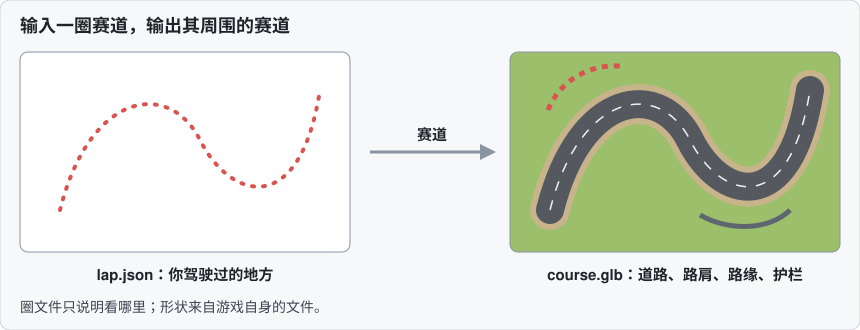
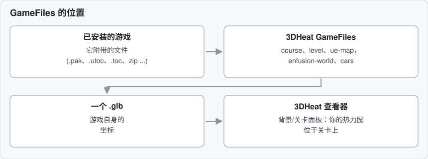

# 3DHeat GameFiles {#dheat-gamefiles}

**这是什么？** 一个工具，可以根据你已经安装的游戏的文件，构建赛道或游戏关卡的 3D 模型。

**我为什么要用它？** 3DHeat 查看器会把你驾驶或游玩过的地方以热力图的形式涂上颜色。使用本工具后，热力图会绘制在真实的赛道或关卡上，而不是空白的地方。

**示例：** 取一圈你驾驶过的赛道。工具会把它周围的道路和地面构建成一个 3D 文件，这样查看器就能把你的速度或撞车情况绘制在真实的赛道上：



第一次使用命令行？请先阅读 [开始之前](before-you-start.md)。

更详细地说：它从游戏附带的归档中读取关卡数据，并把它写成二进制 glTF（`.glb`）文件。它的主要工作是**赛道导出**：你给它一圈赛道，它就会写出地面、道路（与路肩和草地区分开）、路缘、护栏、轮胎墙、标志牌以及周围的建筑。

它是 [3DHeat](https://github.com/Holdi601/3DHeat) 的一部分。3DHeat 是一个用于实时 3D 遥测热力图、赛车分析和对局回顾的查看器（[文档](https://holdi601.github.io/3DHeat/)）。本工具写出的 `.glb` 文件，就是查看器绘制热力图所依托的关卡。



要把关卡几何数据导入 3DHeat，有三种途径：

| 途径 | 需要 | 得到 |
|---|---|---|
| 3DHeat Unreal Exporter | 在编辑器中打开的 Unreal 项目 | 精确的几何 |
| 3DHeat GameCapture | 一个屏幕和一次截取 | 估计值 |
| **3DHeat GameFiles** | **已安装的、游戏自带的文件** | **精确的几何，无需项目** |

Python 包名为 `heat3d_gamefiles`。代码仓库：
[Holdi601/3DHeat-GameFiles](https://github.com/Holdi601/3DHeat-GameFiles)。许可证：MIT。

## 它能做什么 {#what-it-can-do}

| 游戏或引擎 | 赛道导出（`course`） | 归档读取 |
|---|---|---|
| Forza Horizon（ForzaTech） | 是：地形、道路和路肩、地面贴图、以自身贴图呈现的放置模型 | 对 `.minizip` 使用 `identify`、`list`、`extract`；对 `.modelbin` 使用 `identify`；通过 `course` 和 `terrain` 读取模型、地形和贴图 |
| BeamNG.drive | 是：地形、道路贴花、建模的赛道、放置的模型、水域 | 对关卡 zip 使用 `identify`、`list`、`extract`；对 `.ter`、`.cdae` 使用 `identify`；通过 `course` 读取 `.dae` |
| Assetto Corsa Rally（Unreal 5.6） | 是：赛段地面瓦片、烘焙的地面颜色、以平面颜色呈现的放置模型 | 对 IoStore `.utoc`/`.ucas` 使用 `identify`、`list`、`extract`；通过 `course` 读取 zen 包、静态网格和贴图 |
| Unreal `.pak`（版本 8-12） | 否 | `identify`、`list`、`extract` |
| Unity（格式 22 及以后） | 否 | `identify`、`meshes` |
| Battlefield 6（Frostbite `.toc`/`.cas`） | 不支持赛道；使用 `level` 导出整个关卡：地形、放置的网格，以及加上 `--textures` 后的颜色贴图 | `identify`、`levels`；通过 `level` 读取 bundle、网格、地形、贴图和放置信息 |
| Source 2 `.vpk` | 否 | `identify`、`list`、`extract` |
| Unreal 5 World Partition 游戏 | 不支持赛道；使用 `ue-map` 导出整张地图（用 `ue-maps` 列出）：地形、HLOD 建筑和道具、水域 | - |
| Arma Reforger（Enfusion） | 不支持赛道；使用 `enfusion-world` 导出整个世界（用 `enfusion-worlds` 列出）：以其颜色呈现的地形、海洋、以方盒表示的建筑 | - |
| Forza（汽车） | `cars`：每辆车以低细节导出，供查看器的赛车标签页使用 | - |

Assetto Corsa EVO 和 iRacing 的赛道会被拒绝，并附有原因。参见 [限制与已知缺口](../limits-and-known-gaps.md)。

## 安装 {#install}

第一次使用命令行？请先阅读 [开始之前](before-you-start.md)。

你需要 **Python 3.10 或更高版本**（开发环境为 3.13），以及 [`requirements.txt`](https://github.com/Holdi601/3DHeat-GameFiles/blob/main/requirements.txt) 中列出的软件包。

```
git clone https://github.com/Holdi601/3DHeat-GameFiles.git
cd 3DHeat-GameFiles
pip install -r requirements.txt
```

然后检查它是否可用：运行 `python -m heat3d_gamefiles --help`。你应该会看到
`usage: heat3d_gamefiles [-h]` 以及命令列表。请始终在代码仓库文件夹中运行每条命令，形式为 `python -m heat3d_gamefiles <verb>`。

| 软件包 | 用途 |
|---|---|
| numpy | 所有解码几何数据的工作 |
| lz4 | Forza 归档（大多为 LZ4 块）、一些 Unity bundle、IoStore 的 LZ4 块 |
| Pillow | 解码 BC1-BC7 贴图，在 `.glb` 中写入 JPEG 贴图 |
| msgpack、zstandard | BeamNG 的已编译形状（`.cdae`） |
| cryptography | 仅用于使用你已持有的密钥打开加密的 `.pak` |
| pytest | 测试 |

使用 **Oodle** 压缩的 Unreal 内容需要一个你的电脑上已经存在的 Oodle 库。本工具从不附带该库。参见 [Oodle](../reader-oodle.md)。

本工具是为 Windows 编写的。它通过 Steam 的库列表和 `%LOCALAPPDATA%` 查找游戏，并将 Oodle 作为 Windows DLL 加载。其他平台尚未测试。

## 快速开始 {#quick-start}

**圈文件（lap file）**记录了你的车去过哪里：即一串 x、y、z 点。它来自 [3DHeat GameCapture](https://github.com/Holdi601/3DHeat-GameCapture)，或来自 FH Companion 应用的圈速库；手动输入的 CSV 也可以（[圈速输入](../lap-inputs.md)）。

```
# Forza：一个圈文件、一个圈文件夹，或 FH Companion 库中的赛道名称
python -m heat3d_gamefiles course "Example Circuit"
python -m heat3d_gamefiles course path\to\lap.json -o course.glb

# BeamNG.drive 或 Assetto Corsa Rally：heat3d-lap 文件会说明它来自哪款游戏
python -m heat3d_gamefiles course my_lap.json

# FH Companion 库中的每条赛道，每条一个 .glb
python -m heat3d_gamefiles courses -o courses

# Battlefield 6：先列出关卡，然后导出一个（文件很大；参见命令）
python -m heat3d_gamefiles levels
python -m heat3d_gamefiles level <level> -o level.glb --textures

# Unreal 5 World Partition 与 Arma Reforger：先列出，然后导出
python -m heat3d_gamefiles ue-maps "<game>"
python -m heat3d_gamefiles ue-map "<game>" <map> -o map.glb
python -m heat3d_gamefiles enfusion-worlds
python -m heat3d_gamefiles enfusion-world <world> -o world.glb

# 每一辆 Forza 汽车，供查看器的赛车标签页使用
python -m heat3d_gamefiles cars -o forza.h3dcars

# 这是什么文件？
python -m heat3d_gamefiles identify some_archive.pak
```

用 3DHeat 查看器打开 `.glb`。游戏自身的世界坐标会被保留（参见 [输出格式](../output-format.md)），因此记录下来的一圈赛道会与赛道线对齐。

## 本文档的地图 {#map-of-this-documentation}

- [开始之前](before-you-start.md)：Python、终端、第一条命令。
- [命令](../commands.md)：每个动词和选项，附示例。
- [命令参考](../cli-reference.md)：每个动词的 `--help`，由代码生成。
- [检查归档](../inspecting-archives.md)：`identify`、`list`、`extract`、`meshes`，逐步说明。
- [赛道导出](../course-export.md)：一圈赛道如何变成赛道，适用于所有游戏。
  - [Forza Horizon](../course-forza-horizon.md)
  - [BeamNG.drive](../course-beamng.md)
  - [Assetto Corsa Rally](../course-assetto-corsa-rally.md)
  - [细节层级与预算](../detail-budget.md)
- [整个关卡](../whole-levels.md)：无需圈速的关卡、地图或世界。
  - [Battlefield 6 关卡](../level-battlefield.md)：`levels`、`level`
  - [Unreal 5 地图](../level-unreal-world-partition.md)：`ue-maps`、`ue-map`
  - [Arma Reforger 世界](../level-arma-reforger.md)：`enfusion-worlds`、`enfusion-world`
- [Forza 汽车](../forza-cars.md)：`cars`，供查看器赛车标签页使用的汽车文件。
- [圈速输入](../lap-inputs.md)：工具接受的每一种圈文件格式。
- [输出格式](../output-format.md)：`.glb` 内部的内容。
- [归档读取器](../archive-readers.md)：每种容器格式一页，说明它读取什么、不读取什么，以及原因。
- [限制与已知缺口](../limits-and-known-gaps.md)
- [故障排除](../troubleshooting.md)：错误信息及其处理方法。
- [规则与许可](../rules-and-licences.md)：不使用密钥、使用你自己的文件、不再分发。
- [更新](../updates.md)：更新检查与 `heat3d_update`。
- [开发](../development.md)：模块图与测试，包括针对已安装游戏运行的测试。
- [维护](../maintaining.md)：这些页面的发布检查清单。

## 属于 3DHeat 的一部分 {#part-of-3dheat}

3DHeat GameFiles 是 3DHeat 查看器周围的免费工具之一：

| 工具 | 作用 | 文档 |
|---|---|---|
| [3DHeat](https://github.com/Holdi601/3DHeat) | 查看器：在浏览器中显示 3D 热力图、赛车分析和对局回顾 | [站点](https://holdi601.github.io/3DHeat/) |
| [GameFiles](https://github.com/Holdi601/3DHeat-GameFiles) | 从游戏附带的文件中提取赛道和关卡，输出为 `.glb` | [站点](https://holdi601.github.io/3DHeat-GameFiles/) |
| [GameCapture](https://github.com/Holdi601/3DHeat-GameCapture) | 赛车游戏的圈速遥测；从游戏视频重建的关卡 | [站点](https://holdi601.github.io/3DHeat-GameCapture/) |
| [Unreal Exporter](https://github.com/Holdi601/3DHeat-UnrealExporter) | 一个 Unreal 编辑器插件，将关卡保存为 `.glb` | [站点](https://holdi601.github.io/3DHeat-UnrealExporter/) |
| [CS2](https://github.com/Holdi601/3DHeat-CS2) | 将反恐精英 2 录像转为对局文件；将地图转为 `.glb` | [站点](https://holdi601.github.io/3DHeat-CS2/) |
| [Watcher](https://github.com/Holdi601/3DHeat-Watcher) | 在后台根据游戏公开的数据记录你的游戏过程 | [站点](https://holdi601.github.io/3DHeat-Watcher/) |
| [Ext-WarThunder](https://github.com/Holdi601/3DHeat-Ext-WarThunder) | 将战争雷霆的录像转为对局文件 | [站点](https://holdi601.github.io/3DHeat-Ext-WarThunder/) |
| [Ext-WoT](https://github.com/Holdi601/3DHeat-Ext-WoT) | 将坦克世界的录像转为对局文件 | [站点](https://holdi601.github.io/3DHeat-Ext-WoT/) |
| [Ext-WoWs](https://github.com/Holdi601/3DHeat-Ext-WoWs) | 将战舰世界的录像转为对局文件 | [站点](https://holdi601.github.io/3DHeat-Ext-WoWs/) |
| [Ext-Squad](https://github.com/Holdi601/3DHeat-Ext-Squad) | 将 Squad 服务器录像转为对局文件 | [站点](https://holdi601.github.io/3DHeat-Ext-Squad/) |
| [Ext-DCS](https://github.com/Holdi601/3DHeat-Ext-DCS) | 将 DCS World 地图转为 `.glb` 关卡 | [站点](https://holdi601.github.io/3DHeat-Ext-DCS/) |
| [Ext-IL2](https://github.com/Holdi601/3DHeat-Ext-IL2) | 将 IL-2 Sturmovik 地图转为 `.glb` 关卡 | [站点](https://holdi601.github.io/3DHeat-Ext-IL2/) |

查看器的对局文件见 [一场对局一个文件：`.3dheat`](https://holdi601.github.io/3DHeat/container.html)；
在这里制作的关卡则在查看器的背景/关卡面板中与它们一起加载。
